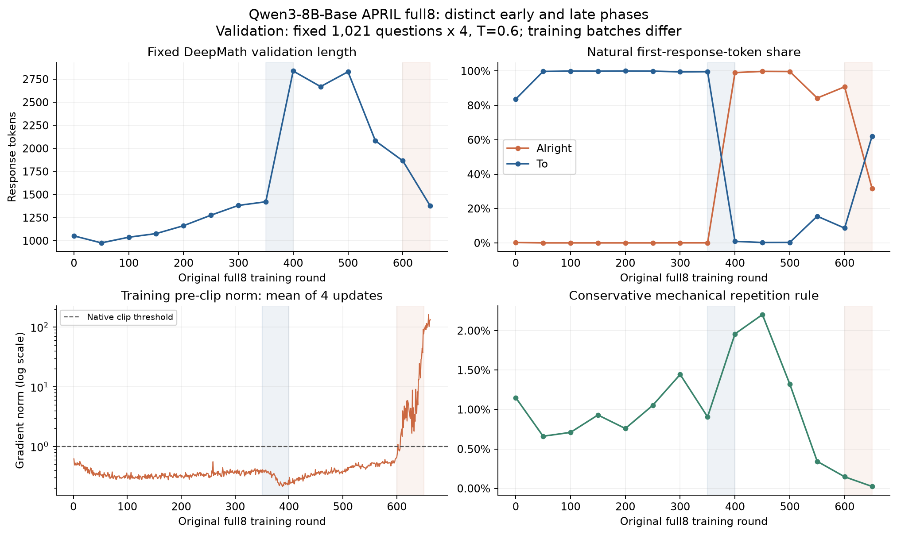
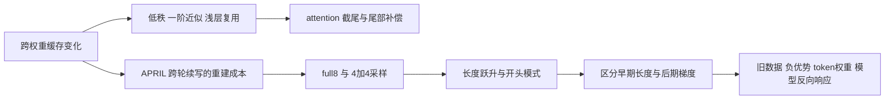

# RL Rollout 与训练稳定性研究

这个项目研究数学推理强化学习中的一个共同问题：**怎样减少 rollout 的重复计算和长尾开销，同时理解采样规则对训练信号、输出行为和稳定性的影响？**

研究从相邻 checkpoint 的 KV-cache 变化开始，经过浅层复用、稀疏 attention、4+4 分组采样与 APRIL 长跑，逐步进入长度跃升、首 token 模式选择、异常输出和后期梯度放大的诊断。这里保留实验结果，也保留没有奏效的方案、实现问题和解释发生变化的过程。

**最新研究报告：** [从输出长度跃升到梯度异常](reports/rl-length-gradient-investigation.md)（2026-11-06）。从最早的 BBB 长度跃升，串起首 token、数据与 Base、后期概率失配、负优势、循环机制和反重复训练；包含失败方案、实现混淆和结论修正。

## 从哪里开始

| 研究线 | 想回答的问题 | 内容 |
|---|---|---|
| [跨权重缓存重建](docs/cache-reconstruction.md) | 已知权重更新，能否避免完整重算旧前缀？ | E/K/V/Q 增量、低秩与函数拟合、一阶近似、浅层复用、attention 截尾、逆推 Q |
| [分组采样与效率](docs/group-sampling.md) | 哪些回答值得继续生成，省下的生成是否变成真实收益？ | full8、4+4、race4、seqfirst、小模型筛选、跨轮成本、100 次首中测试 |
| [长度与梯度稳定性](docs/training-stability.md) | 长度、PPL、异常输出和梯度峰值分别由什么驱动？ | 首 token 干预、Base 异常、负优势、旧数据校正、固定输入反传、统一 full8 主线 |

建议先读这三章中的一章，再进入[实验索引](experiments/README.md)核对设置和证据。研究中的数学问题单独整理在[优化目标与采样偏差](docs/theory-notes.md)。

## 当前最重要的认识

1. **缓存增量有结构，不意味着已有便宜的在线重建器。** 浅层 E/V 小变化给出了复用方向；oracle 低秩拟合、实际网络 JVP 和真实加速仍是不同层次的问题。[缓存研究](docs/cache-reconstruction.md)
2. **少生成回答不一定更快。** 4+4 的阶段等待、不同输出长度和筛选分布共同影响成本。首版 race4 的取消未真正生效，该结果被排除出有效加速比较。[采样研究](docs/group-sampling.md)
3. **长度跃升不等于梯度爆炸。** full8 同一条轨迹在 350→400 轮长度约翻倍，梯度仍较小；600→650 轮固定评测长度和机械重复下降，梯度却明显增长。[统一主线](docs/training-stability.md)
4. **降低梯度范数不等于修复输出质量。** 历史 batch 重放和在线分支说明旧回答权重与负优势通道有作用，但 TIS 带来的梯度改善没有自动转化为更少的异常文本。[稳定性对照](docs/training-stability.md)



图中固定验证与训练指标分别标明。所有梯度范数均为裁剪前；不能把它们当作 Adam 的实际更新大小。

## 实验与思路如何串起来



完整过程见[问题与决策](docs/questions-and-decisions.md)，实验身份与模型区别见[设置对照](docs/setup-comparison.md)。

## 最新状态

- **full8 650→850 已完成**：200轮、800次更新，实际入训失配与逐次梯度已纳入报告；这是新续训分支，不是原历史逐样本重演。
- **720固定E-only辅助损失研究已完成训练**：共执行50轮，四个优先自然评测节点已齐；未显示优于baseline，旧strict指标还漏掉了数字循环。
- **600→620在线循环bank短训已完成**：20轮、80次更新，循环候选0→43→117/512，正确率51.17%→49.61%→44.53%。没有匹配baseline，不能称成功预防，也不能把全部退化归因于UL。

[完整报告](reports/rl-length-gradient-investigation.md) · [52项证据主张](experiments/stability-investigation.md) · [当前状态快照](progress/investigation.md) · [检测与损失参考代码](reference/antiloop/README.md)

## 仓库结构

| 目录 | 用途 |
|---|---|
| [reports](reports/README.md) | 连贯的研究报告，含关键对照、图表、局限与后续问题 |
| [reference](reference/antiloop/README.md) | 实际使用过的检测/损失核心及CPU测试，不是完整训练框架 |
| [docs](docs/README.md) | 研究章节、指标定义、理论笔记和下一步问题 |
| [experiments](experiments/README.md) | 实验与证据单元索引，包含设置、结果、状态和限制 |
| [data](data/README.md) | 可发布的聚合数据、来源摘要与 SHA256 |
| [figures](figures/README.md) | 从仓库内聚合数据生成的研究图 |
| [tools](tools/README.md) | 重绘图表、核对文档链接与证据编号 |
| [progress](progress/README.md) | 当前研究进度与旧进度页入口 |
| [history](history) | 原有实验进度归档，保留历史内容 |

早期版本整理了 **45 个实验与证据单元**，并保留原有 **17 份历史实验目录**。新报告另梳理 **52 项证据主张**，与旧索引有重叠；这些数量均不是独立训练重复次数。

## 如何复核

```bash
python tools/check_project.py
python tools/check_investigation.py
python -m pip install -r requirements-analysis.txt
python tools/render_figures.py
python tools/render_investigation_figures.py
```

脚本使用仓库内的聚合数据，不需要模型或 GPU。[指标与证据说明](docs/measurement-guide.md)解释了 PPL、概率差、梯度、首中覆盖及异常标签的不同口径。

完整训练状态、权重和逐题回答不放入这个仓库，因此当前交付包含研究报告、聚合证据、图表重绘与两个实际使用的检测/损失核心模块；完整训练复现包仍待整理。继续添加实验时，沿用[记录模板](experiments/TEMPLATE.md)与[维护约定](CONTRIBUTING.md)。

相关论文及与本项目的区别见[相关工作](docs/related-work.md)。仓库沿用 `dapo-training-progress` 的地址，项目入口现已覆盖整个研究过程。

<!-- final-stability-progress:start -->
## 新增：600→650八组稳定性实验（逐组更新）

**当前纳入4/8组训练、5/9个次要评测端点。** 每种方法各一条在线轨迹；全量候选文本统计尚有明确缺口。主要数值由冻结聚合CSV生成，方法解释见逐组记录；本快照不代表八组最终排名。

本次新增Absolute-gap mask完整50轮：最大梯度254.57，7次超过100；16,345,831个屏蔽位置的实际直接loss系数为0已核验。次要面板为69.73%，相对baseline差值区间[−0.59,+6.25]个百分点，不能据此证明准确率改善。前三组候选统计已全量齐全，第四组本快照只保留601–607轮；报告加入628轮的有界核查。

[逐组实验与曲线](experiments/final-stability-600-650.md) · [报告更新](reports/rl-length-gradient-investigation.md#final-stability-600-650) · [数据状态](data/final-stability-600-650/manifest.json) · [损失与检测实现](reference/stability/README.md)

运行 `python tools/check_final_stability_progress.py` 核对已完成部分。严格八组最终验收尚未通过；原45项研究单元与52项报告claims保留，S16继续逐组更新。
<!-- final-stability-progress:end -->
