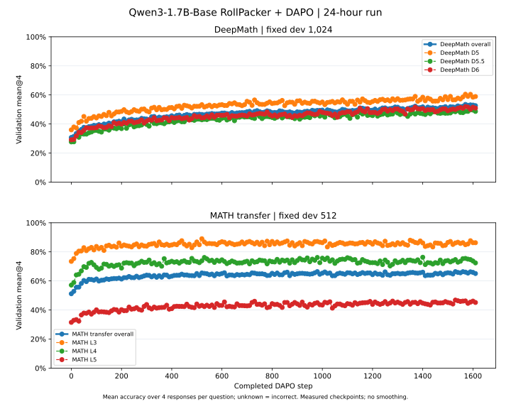
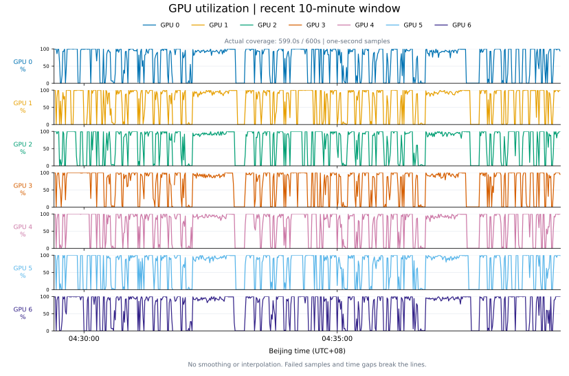
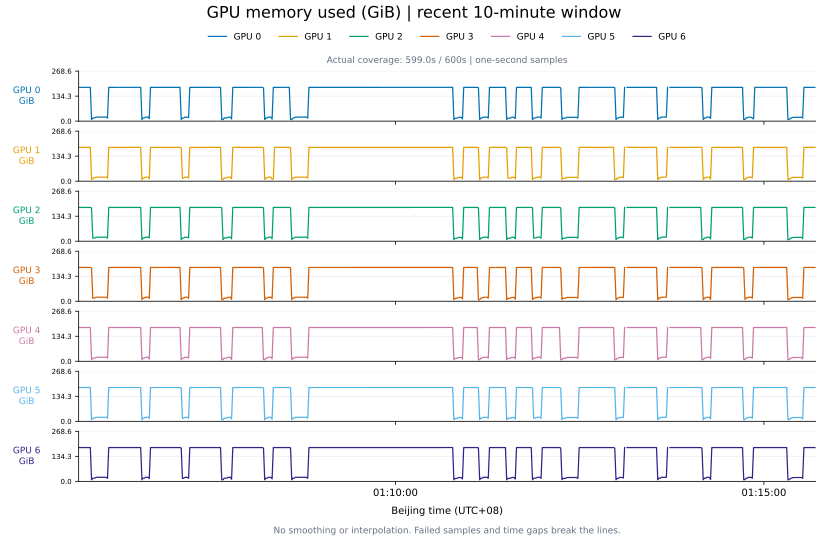

# Qwen3-8B-Base · APRIL 8 同发 + DAPO · 12h

更新时间：2026-10-31T22:58:32+08:00（北京时间，约每 60 秒同步）。

状态：**running**；已记录完成更新 **0**；GPU 分配累计 **0.11 / 12 小时**。
计时从本次独立 GPU allocation ledger 开始，包含初始化、初评、训练、评估与收尾；不按首条训练日志计时。

配置：Qwen3-8B-Base 从 Base 开始；8×B300；APRIL pending W=256；每轮选64个完整有效组；每题8答同发，无4+4提前舍弃。
回答上限8192 tokens，prompt上限2048；每50轮评估、每50轮保存，保留2个checkpoint。学习率5e-7。

训练：DeepMath-103K派生 open-v4 **40,299题**，uniform shuffle。验证：hard-dev **1,021题** + 完整公共 **600题**；每题4答。
独立calibration508题不进入训练。训练池仍有1,629条review-only题保留；规则修订不代表全部题意或金标已被证明无误。

质量指标为 **mean@4（4条回答平均正确率）**，不是pass@4；hard-dev总体按五个难度桶的实际题数加权。公共四项分别报告。
正式初始分数只从本run已完成的step0评估读取；初评完成前显示待测。

| 指标 | 题数 | 最新 mean@4 | 历史最佳 mean@4 |
|---|---:|---:|---:|
| DeepMath hard-dev | 1021 | 55.88% | 55.88% |
| DeepMath D5-6 | 128 | 57.81% | 57.81% |
| DeepMath D6-7 | 255 | 54.90% | 54.90% |
| DeepMath D7-8 | 319 | 57.29% | 57.29% |
| DeepMath D8-9 | 272 | 54.87% | 54.87% |
| DeepMath D9-10 | 47 | 52.13% | 52.13% |
| AIME24 | 30 | 15.00% | 15.00% |
| AIME25 | 30 | 15.00% | 15.00% |
| AMC23 | 40 | 55.62% | 55.62% |
| MATH500 | 500 | 74.15% | 74.15% |

GPU图只使用本次独立1秒遥测；SVG可能降采样显示，CSV保留窗口内数值。缺测不填成0。

[验证汇总CSV](validation.csv) · [训练速度汇总CSV](training.csv) · [GPU窗口CSV](gpu_10m.csv) · [状态JSON](status.json)

只发布允许的配置、聚合数值和图；不发布题目、回答、CoT、题目ID、权重或私有文件路径。

## 历史实验

- [20261021-dapo-deepmath7-scalar-400](history/20261021-dapo-deepmath7-scalar-400/README.md)
- [20261022-base-deepmath-20k-24h](history/20261022-base-deepmath-20k-24h/README.md)
- [20261023-april-deepmath-20k-24h](history/20261023-april-deepmath-20k-24h/README.md)
- [20261025-rollpacker-deepmath-20k-24h](history/20261025-rollpacker-deepmath-20k-24h/README.md)
- [20261025-rollpacker-deepmath-70-fresh-24h](history/20261025-rollpacker-deepmath-70-fresh-24h/README.md)
- [20261026-tailsieve-deepmath-64-fresh-24h](history/20261026-tailsieve-deepmath-64-fresh-24h/README.md)
- [20261027-rollverify-deepmath-112-fresh-24h](history/20261027-rollverify-deepmath-112-fresh-24h/README.md)
- [20261029-april-discard8-w256-g64-from0-24h](history/20261029-april-discard8-w256-g64-from0-24h/README.md)
- [20261030-april-cpuopt-discard8-w256-g64-eval50-from0-24h](history/20261030-april-cpuopt-discard8-w256-g64-eval50-from0-24h/README.md)
- [20261030-april-cpuopt-discard8-w256-g64-from0-24h](history/20261030-april-cpuopt-discard8-w256-g64-from0-24h/README.md)
- [20261030-april-eight-w256-g64-eval50-from0-20h](history/20261030-april-eight-w256-g64-eval50-from0-20h/README.md)
- [20261031-setup2-qwen3-8b-april-eight-w256-g64-8k-from0-12h](history/20261031-setup2-qwen3-8b-april-eight-w256-g64-8k-from0-12h/README.md)
