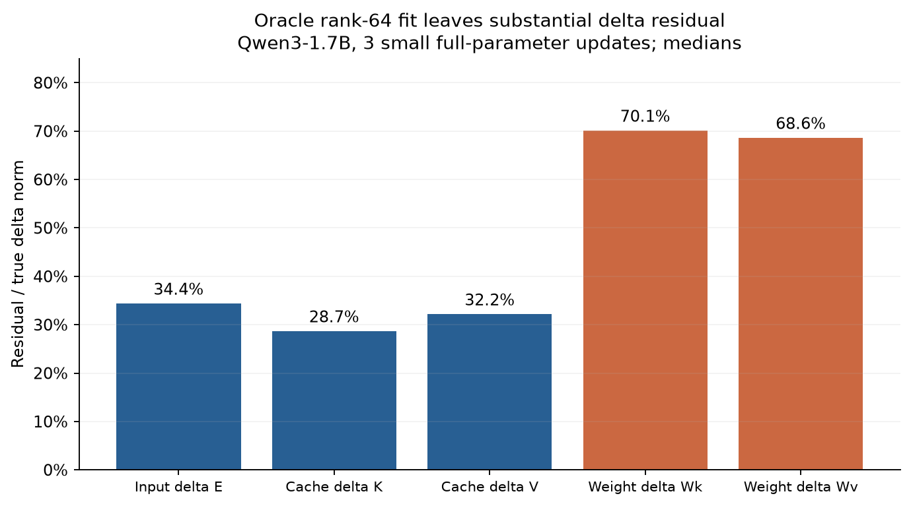

# 跨权重 KV-cache 重建：从增量结构到 attention 近似

这条研究线从一个问题开始：模型更新后，能否利用旧缓存和已知参数增量，低成本得到新缓存？我们先测结构，再做重建误差实验，最后检查概率分布的变化。目前得到了一些可继续研究的方向，但还没有实现并验证训练中的缓存更新加速。

## 实验边界和记号

主要精细诊断来自 **Qwen3-1.7B thinking + DeepMath**：全参数 AdamW，学习率 `1e-6`，每轮 32 题、每题 8 个回答、一次更新，共保存 000–003 四个 checkpoint。输入上限 2048、回答上限 8192。固定同一串 token 比较相邻权重；主测量用 FP32、禁用 TF32，谱统计最多抽取 512 个位置。四道未参与训练的探针题在不同更新间重复使用，不能当成十二道独立题。[C01](../experiments/evidence.md#c01)

`E` 指每层输入归一化之后、Q/K/V 投影共同使用的表示；`K_raw` 是线性投影，真正的 Qwen K-cache 还经过 K 归一化与 RoPE。全文区分三种量：增量大小 `‖新−旧‖/‖旧‖`、重建误差 `‖预测−新‖/‖新‖`、增量拟合误差 `‖预测增量−真实增量‖/‖真实增量‖`。三者不能混读。输出检查主要是固定后续 token 的 teacher forcing，并非自由生成整题准确率。

## 1. 增量看起来有规律，能否压缩或预测？

若用行向量表示输入，线性投影满足：

\[
(E+e)(W+w)=EW+eW+Ew+ew.
\]

已知参数变化 `w`，不代表已知上游表示变化 `e`；反向传播的梯度也不是更新后激活的变化量。这正是重建问题的主要缺口。

**低秩实验。** 实际全参数更新没有预设 LoRA。未参与训练的探针中，E、K-cache、V-cache 的相邻相对变化中位数约为 **0.296%、0.214%、0.406%**；rank-64 最优拟合仍分别留下 **34.4%、28.7%、32.2% 的增量误差**。权重增量更难低秩拟合：Wk/Wv 的 rank-64 残差中位数约 70.1%/68.6%。它们的图像像噪声，不等于已证明其元素独立或没有结构。[C01–C02]

**从灰度图到函数拟合。** E/K/V 的绝对值图常有网格、条纹，但去掉符号后容易产生“很容易拟合”的错觉。我们分别拟合带符号增量和绝对值，尝试行列均值、二维 Fourier、逐通道 Fourier、Chebyshev 多项式、样条和自适应频谱。二维 Fourier 最高测试阶数 32，在留出的 token 行上，E/K/V 带符号增量误差仍约 **99.85%/99.65%/100.14%**。视觉规律没有转化成紧凑、可泛化的坐标函数。[C03](../experiments/evidence.md#c03)

**不依赖低秩的尝试。** 用独立校准题拟合通道仿射映射、逐头 ridge 映射，或重算末尾 4/8 层，再测新模型后续 64 个位置。短前缀主实验中，前两种映射使平均 KL 相对直接复用旧缓存下降约 **28%**；只修末尾层改善有限。直接沿历史增量外推反而使匹配样本的 KL 上升约 **45%**，拟合外推系数后仍未稳定优于旧缓存。量化和稀疏化也做过 oracle 增量诊断，但没有稀疏内核或在线增量来源。[C04](../experiments/evidence.md#c04)

## 2. 已知所有参数增量，一阶传播能做到什么？

我们区分了三种方案：

| 方案 | 实际知道什么 | K/V 增量误差中位数 |
|---|---|---:|
| 旧 E × 新投影参数 | 不计算上游 e | 99.97% / 99.84% |
| 已知真实 e，保留 eW+Ew | 使用了真实新表示，属于 oracle | 0.0245% / 0.0163% |
| 全网络 JVP | 旧权重、实际全部参数增量、固定 token | 5.91% / 6.52% |

这说明小步下 `ew` 交叉项很小；真正困难的是获得 `e`。全网络 JVP 穿过归一化、softmax、MLP 与残差，不偷看真实新 E。它明显改善重建，但误差在中高层和少数样本集中：K/V 的能量汇总增量误差仍为 34.9%/38.2%。其后续分布平均 KL 从旧缓存的 `2.74e-5` 降到 `2.40e-7`；当前实现重新计算旧前向并增加切向计算，耗时约为完整新 prefill 的 **2.96 倍**。[C05](../experiments/evidence.md#c05)

我们也对残差做最优低秩拟合。在六个可视化案例、512 个抽样位置的范围内，rank-32 残差修正后，JVP 的 K/V 增量误差中位数为 **0.81%/0.72%**；旧 E × 新 W 的对应误差仍为 **39.1%/41.4%**。这些拟合需要真实残差，只说明“残差可以如何表示”，还没有解决“在线如何预测残差”。[C06](../experiments/evidence.md#c06)

## 3. 浅层 E/V 复用，K 重算

逐层统计发现，前十层的变化能量占全部 28 层变化能量的中位数，E 仅 **0.0209%**、V 仅 **0.0361%**，K 则为 **10.56%**。这支持一个分层方案：保存浅层旧 E 和旧 V，用新 Wk 从旧 E 重算 K，再完整重算中高层。浅层 K 的局部投影可以层间并行；Qwen 的 K 还需使用新归一化参数与原位置旋转。[C07](../experiments/evidence.md#c07)

但证据目前只到“值得试”。浅十层保持旧 KV、深层直接注入真实新 KV 的敏感性对照，平均 KL 为 `5.74e-7`；它依赖深层真值，并不是完整可执行的快速重建。拟议方案还需要明确中高层入口残差状态、旧 E 的额外存储、实际重算成本，以及连续多轮近似的累积误差。**尚未完成该混合方案的在线长跑。**

为扩展时间尺度，另做了 **Qwen3-0.6B-Base + GSM8K** 的正常 DAPO 与 APRIL 长跑，回答上限 4096、G8、每轮选 24 个有效组、学习率 `5e-7`，每十轮验证。保存报告覆盖 baseline 2850 轮、APRIL 3300 轮；在匹配的 2360–2850 区间，验证正确率平均约 **84.68%/83.31%**。它们是后续分析 checkpoint 漂移的权重轨迹，不是上述浅层复用法的训练结果。当前已核对的报告尚不能给出这两条长跑在不同间隔上的完整 E/K/V 漂移矩阵。[C08](../experiments/evidence.md#c08)

Q 侧也做了同位置测量：Q 与 K/V 使用同一个 E，但 Q 有 16 个头、KV 只有 8 个头。局部替换旧 Q、旧 K、旧 V 的对照均影响 attention 输出；Q/K 得分变化项会相互抵消，不能把各项范数当作可相加的贡献百分比。[C17](../experiments/evidence.md#c17)

## 4. 利用旧 attention 的稀疏位置重建

另一条思路：旧权重推理时保存每个 query 主要关注哪些历史 token，新权重重建时只计算这些位置。相邻小更新中 attention 确实相对稳定：三组更新的平均 TV 约 **0.203%、0.141%、0.103%**；但少数单行可明显偏移，不能只看平均值。[C09](../experiments/evidence.md#c09)

**固定 top-100 不够。** 它平均只覆盖新 attention 约 90% 的质量，重建后的平均 K/V 相对误差约 **8.32%/16.94%**，后续 32 个固定 token 的分布 TV 约 **3.79%**。即使用真实新 attention 的 top-100 作为 oracle，结果也几乎不变。因此本实验的主要误差来自截掉尾部，而非旧新 attention 位置变动。[C10](../experiments/evidence.md#c10)

改为按旧 attention 累计质量选择，得到以下匹配对照：

| 选择与尾部处理 | 保留 QK 点积比例 | K/V 重建误差 | 后续分布平均 TV |
|---|---:|---:|---:|
| top-100，尾部置零 | 2.76% | 8.32% / 16.94% | 3.79% |
| 99%，尾部置零 | 21.80% | 0.981% / 2.213% | 0.277% |
| 99.9%，尾部置零 | 46.48% | 0.100% / 0.224% | 0.0269% |
| 99.9% + 均值尾部 | 46.50% | 0.0725% / 0.1586% | 0.0219% |

均值尾部用新的 q/K/V：通过因果前缀和减去已选位置，得到剩余 K、V 的均值，并把尾部数量计入 softmax 分母。这样能精确算出平均 logit，但 `exp(平均logit)` 不等于 `平均exp(logit)`；算术平均 V 也不等于真实 attention 加权 V。top-100 加均值未稳定改善后续分布，99.9% 下则更有帮助。[C11–C12]

这些是 4 道 heldout 题、3 个相邻更新、前缀 1950–8160 token 的结果。点积比例只计算逻辑 QK 对；准确性实现仍使用稠密 logits 后 mask，没有包括位置索引、前缀和、访存和其他层运算，**不能据此声称模型加速 53% 或 97%**。

## 5. 能从旧 KV 反推出旧 Q 吗？

Qwen3-1.7B 的 Wv 为 `1024×2048`（框架存储方向），28 层都满行秩，但 GQA 使输出维数不足，单独 V 无法唯一恢复一般 E。更准确的条件是：若只要求 Q 唯一，需要 V 看不见的方向也都不影响 Q；本模型实验并不满足这种理想恢复。[C13](../experiments/evidence.md#c13)

联合原始 K/V 的投影矩阵在 FP64 阈值下满秩，但条件数很大；实际缓存 K 已归一化，数值尺度的信息恢复又不稳定。对 checkpoint 003、四道探针的同权重恢复，V 的最小范数逆得到 Q 相对误差约 **76.5%**；联合 K 方向约束降到 **11.0%**，attention TV 约 **3.91%**。把缓存模拟量化到 BF16 后，后者 Q 误差增至 **103.8%**。使用未缓存的原始 K 作正对照，Q 误差仅 **0.0175%**：说明关键障碍包含信息缺失与病态求逆，而不仅是实现错误。[C14](../experiments/evidence.md#c14)

为检查没有 GQA 时的情形，测了 **Pythia-1.4B** 的 24 层 Wv：均为 `2048×2048`，FP64 阈值下秩 2048，但 FP32 阈值下只有 2046–2047，条件数约 **4.8千–25.3万**。方阵满秩时，数学上可以从 V 求出投影输入 E，再计算 Q；实际缓存精度下仍可能放大误差。这里做的是权重谱分析，未完成 Pythia 的端到端 Q 恢复评测。[C15](../experiments/evidence.md#c15)

## 6. “K 比 V 变化大”需要什么口径？

后续固定 token 比较纠正了早期从灰度图产生的直觉。在 Qwen 的三次本地相邻更新上，K-cache/V-cache 的平均相对变化为 **0.193%/0.389%**；Pythia 公共预训练相邻 checkpoint（间隔 1000 次更新）为 **2.81%/13.81%**。两者的每个被测题目×层×checkpoint 对，K 的相对变化都小于 V。[C16](../experiments/evidence.md#c16)

这不与“浅层 V 的绝对变化很小”矛盾：尺度和分母不同。例如 Qwen 浅十层 K 的增量 RMS 比 V 大，但其原状态也大得多；Pythia K 中还存在较强的跨 token 均值成分。应同时报告绝对 RMS、相对变化、去均值变化和实际 attention/output 误差，不能仅据某张热图决定复用哪一种缓存。两模型的训练阶段、更新间隔不同，数值也不能直接横向归因。

下一步优先补齐长跑 checkpoint 的分层与间隔扫描，再对“浅层旧 E/V + 新 K、中高层重算”做自由生成、连续刷新及端到端时间测试。只有误差、额外存储和实际耗时一起通过，才能把当前的结构发现推进为缓存重建方法。

## 聚合图表

图为增量的相对拟合残差，不能解释为完整缓存误差或在线加速。
