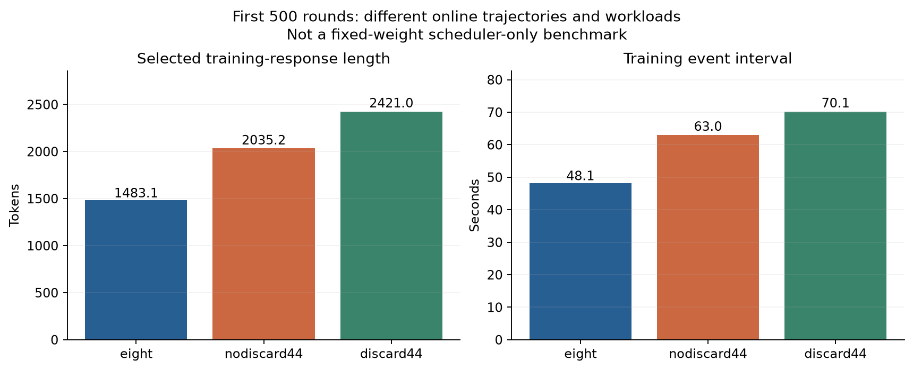
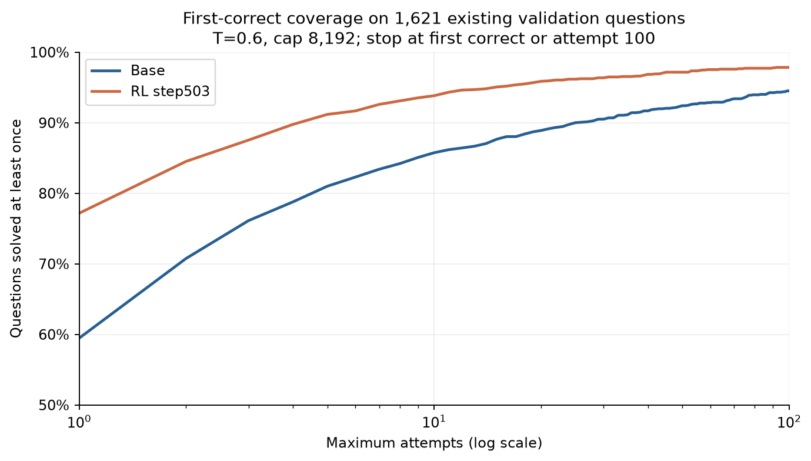

# 分组采样：少生成一些回答，究竟省下了什么？

这条研究线从一个直觉开始：对于同一道题，`1 对 7 错`可能比`7 对 1 错`更值得继续探索。那么，能否先生成 4 个回答，若全部正确就停止，否则再补 4 个？我们希望减少容易题的采样开销，也想知道这种改变会怎样影响模型最终学到的分布。

后来实际遇到的问题超出了“少生成 4 条”本身：分阶段生成会降低并发，提前舍弃会改变样本组成，调度会改变跨轮续写的年龄，而模型输出长度又会反过来改变吞吐。因此，这部分工作的核心是把这些影响逐步拆开。证据编号对应本章的实验索引；设置差异见 [实验设置对照](setup-comparison.md)。

## 从优势权重到提前舍弃

最初讨论的是 GRPO 的组内相对优势。只看二元奖励，标准化优势会给少数正确回答较大的正权重，也会给少数错误回答较大的负权重。`7 对 1 错`并不自动意味着整体“奖励正确多于惩罚错误”：忽略数值稳定项、按总体标准差时，7 个正优势之和与 1 个负优势的绝对值相等；真正的参数更新还取决于各回答的梯度方向、长度、概率比和裁剪。

“更值得学”因而是一个待验证的训练设计选择。我们采用的首四全对舍弃规则会放弃一些原本有正负对比的 G8 组。在早期固定权重、224 道题的试验中，第一阶段全对的 7 组里，6 组的后四条实际上存在错误。[G-01](../experiments/evidence.md#g-01) 这直接说明：首四全对不等价于完整八条全对，也不等价于零训练信号。

我们讨论过调整优势或用纳入概率做期望修正，但这没有成为下述长跑的已实现功能。各分组实现明确记录 `selection_correction=none`。通常，重要性加权要求明确目标分布、知道相应纳入概率，并有足够的支持覆盖；确定性早停、完成时间排序和跨权重续写同时存在时，不能把一个简单权重自动解释为“与原 GRPO 期望相同”。目前这些实验是在研究一个改变采样分布的策略，而非验证已证明无偏的加速器。

## 先把调度成本测清楚

第一轮微实验固定 Qwen3-1.7B-Base 的权重，不进行训练，也不实际舍弃组。我们对相同 224 道题比较八条同发与分两阶段 4+4，使用配对的题目和采样种子，并交替执行顺序。[G-01](../experiments/evidence.md#g-01)

结果是 4+4 总耗时为八条同发的 **1.373 倍**，回答 token 吞吐约为 **69.1%**。第二阶段的 prompt 缓存覆盖率从 **40.73%** 提高到 **57.77%**，但不足以抵消等待首四条生成及判分的成本。同种子也没有产生逐 token 相同的输出，因此比较中同时报告实际工作量，不能把耗时差全归因于调度。

接着，我们在 APRIL 中做了 5 轮的窗口实验，交叉比较八条同发、4+4 和 112/224 个 pending group。[G-02](../experiments/evidence.md#g-02) 扩大窗口可以补充可运行请求；但窗口扩大也改变候选题暴露、未完成工作和训练批次形成过程。较高的 GPU 请求占用不能单独证明端到端加速，5 轮结果也不能代表稳态或质量收益。一个具体观察是：在相同 112 组窗口下，4+4 的可运行请求均值约为八条同发的 **67%**。

之后的 1.7B、4k 旧设置进行了约 20 小时长跑：八条同发完成 2482 次训练轮次提交，4+4 舍弃完成 2640 次，后者多约 **6.4%**。[G-03](../experiments/evidence.md#g-03) 这是该设置下的轨迹结果。更换模型、数据和长度上限后，这个收益没有直接保留下来。

## 8B 三组：省生成不等于省训练时间

新的正式设置使用 Qwen3-8B-Base、40,299 道训练题、8,192 token 回答上限，固定 1,621 道验证题。每轮选 64 个 G8 组，分为 4 次优化器更新，学习率为 5e-7。三个核心条件均为 APRIL 跨轮续写；每次权重变化后，保留 token 前缀并重新构建 KV，未使用近似缓存复用。[G-04](../experiments/evidence.md#g-04)、[G-11](../experiments/evidence.md#g-11)

| 条件 | 组内生成规则 | 原轮次提交数 | 前 500 轮平均训练回答长度 | 前 500 轮平均事件间隔 |
|---|---|---:|---:|---:|
| `eight` / full8 | 八条并发，完整组判分 | 662 | 1,483 tokens | 48.13 秒 |
| `nodiscard44` | 首四条完成并判分后，再发后四条；不提前舍弃 | 541 | 2,035 tokens | 63.03 秒 |
| `discard44` | 首四条全对则丢弃；否则补齐八条 | 503 | 2,421 tokens | 70.09 秒 |

`discard44` 的第 503 轮有 actor 提交和最终权重，但缺少完整轮次指标；统计曲线只使用完整记录。这些是三条独立训练轨迹，不能把每轮时间直接当作固定权重下的纯调度差异。

最显著的新问题是输出长度增长。固定题评测首次达到平均 2,500 token 的记录，分别出现在 `discard44` 第 200 轮、`nodiscard44` 第 250 轮、`eight` 第 400 轮。[G-05](../experiments/evidence.md#g-05) 不舍弃的 4+4 也会增长，因此“只因丢掉容易题，留下更难更长的题”不足以解释全部现象。固定验证题本身也变长，进一步排除了仅靠当轮训练样本组成变化的解释。后续的开头模式、重复和梯度诊断由这条线展开。

质量也没有单一排序。例如在第 500 轮，DeepMath 验证 mean@4 为 `eight` **76.74%**、`nodiscard44` **74.49%**、`discard44` **75.32%**；MATH500 上分别为 **88.30%**、**85.95%**、**89.75%**。[G-04](../experiments/evidence.md#g-04) 每种条件仅一条轨迹，不能据此宣布某个分组方法普遍更优。

## 规则继续演化，也带来新的选择效应

为了避免 4+4 的阶段等待，我们又试了 `race4`：八条一起生成，最先完成并判分的四条若全对，就取消该题剩余回答。它与预先指定的首四条不同，完成时间也参与了筛选。

首版 `race4` 的底层取消请求 ID 映射有误，**实际成功定向取消数为 0**；虽然有筛选和训练，其目标取消机制未成立，120 轮结果被排除出有效方法比较。[G-06](../experiments/evidence.md#g-06) 修复后的 `race4v2` 完成真实取消检查，有 334 轮完整训练记录，且固定验证长度在第 150 轮已超过 2,500 token。这里不补造第 335 轮未完成的指标。[G-05](../experiments/evidence.md#g-05)

另一个分支是 `seqfirst`：每题串行生成并判分，第一次正确就停止，最多 8 次；首答即对及 8 次全错都舍弃，保留的组只能是 `0…01`，实际组大小为 2–8。每轮按完整组拼出 512 个回答。[G-07](../experiments/evidence.md#g-07) 它已有实现预检与正式轨迹，但既改变停止规则，也改变组大小与正负比例。即使配置保留了 `pilot44_mode=eight`，也不能据此把它当作 full8 或“没有提前停止”的对照。

## 小模型是否能复现大模型的不稳定？

为降低探索成本，我们另做了 Qwen3-0.6B-Base、GSM8K、4k 上限的三组实验：八条同发、4+4 不舍弃、4+4 舍弃，各 1,000 轮，单个配对训练种子。[G-08](../experiments/evidence.md#g-08) 这与 8B 的 DeepMath 设置不同；每轮只有 16 组，窗口为 64 组。

三组已经全部完成，均未触发预先规定的“梯度窗口中位数超过早期 5 倍，且验证回落至少 3 个百分点”不稳定筛选条件。最后四次 dev mean@4 的均值为 **86.91%、85.21%、85.69%**，差距未达到触发追加种子重复的 3 个百分点门槛，因而没有继续复制实验。

长度并非完全不变：八条同发的固定 dev 平均长度从第 100 轮约 298 增至第 850 轮约 652，再回落至最终约 556；另外两组最终约为 475 和 385。[G-08](../experiments/evidence.md#g-08) 更准确的结论是：这个缩小设置有长度增长，但没有复现 8B 中那种显著跃升与后期失稳组合。它不能用于排除大模型的问题，也不足以给三种方法排出显著的质量优劣。

## 两个降低长尾成本的旁支

**按同组正确短回答的两倍长度停止。** 我们对历史生成轨迹做了离线反事实估算：一旦已经判定正确的最短回答长度为 L，就在其他未完成回答超过 2L 时停止。[G-09](../experiments/evidence.md#g-09) 在 `eight` 的 675,064 条完整候选回答中，预计中断 **6.79%**、减少 **5.16%** 的 decode token；但被中断的回答中 **60.96%** 原本最终正确。仅看后来进入训练的 mixed G8 组，则预计减少 **8.09%** token，仍会剪掉 11,597 条原本正确的回答。这不是在线训练结果，也未模拟未来权重改变、判分延迟和实际 GPU 排程；节省 token 不能直接换算成相同比例的墙钟加速。

**跨轮是否反复“重建一下、写一点、再暂停”。** 在一份 `discard44` 快照中，完整历史回答有 **96.02%** 最多发生一次跨权重续写。[G-10](../experiments/evidence.md#g-10) 观察到的跨权重调用里，新增不超过 256 token 的调用占 **13.45%**，全部是短续写后结束，没有“短续写后再次暂停”的绝对阈值实例。使用“新增量不超过旧前缀 5%”的相对阈值时仍存在少量反复暂停：66 次，其中 52 次确认下一权重继续。因此这个现象不是绝对不存在，但也不是该快照的主流。

短续写仍可能付出较大重建工作量：上述短调用每新增 1 个 token，约提交 14.04 个未命中的前缀 token。整个恢复调用累计未命中前缀与新输出之比约为 **1.15**。这是 token 工作量统计，原始计时没有分离排队、prefill、decode，不能据此声称某个百分比的训练时间都花在重建上。

## 提高首次正确率，是否也扩大了覆盖？

我们用相同 1,621 道既有验证题，对 Base 和 `discard44` 最终 step503 权重做并发推理：每题最多采样 100 次，首次正确即停止，记录首中次数。温度为 0.6、top-p 为 0.95、回答上限 8k，题目与尝试序号对应的种子配对。[G-12](../experiments/evidence.md#g-12)

| 指标 | Base | step503 |
|---|---:|---:|
| 第一次回答正确 | 59.47% | 77.17% |
| 20 次内至少正确一次 | 88.90% | 95.87% |
| 100 次内至少正确一次 | 94.51% | 97.84% |
| 首中或达到上限为止的总尝试数 | 16,543 | 7,642 |
| 上述过程生成的总回答 token | 2,163.7 万 | 4,007.5 万 |

其中 60 道题只在训练后权重的 100 次内被解出，6 道只在 Base 中被解出，29 道双方都没有成功。训练后明显提高了容易采到正确回答的概率，也提高了这次有限采样的覆盖；但回答变长，使总 token 成本反而增加约 **85.2%**。

这支持“RL 改变了成功概率分配”的观察，不能单凭 100 次内 Base 未解出就证明模型学会了原先绝无可能的新能力。反过来，覆盖确有提升，也不能用这组数据证明“RL 只改变 pass@1、完全不改变可观测覆盖”。此外，这份评测集曾在训练期间反复使用，并非一次全新盲测。

## 这一阶段留下的研究问题

我们已验证实现可运行，也发现了数个会误导比较的因素：少生成不保证更快，取消接口返回不保证实际取消，配置名字不保证真实组协议，训练轮数相同不保证 token 预算相同。接下来需要把质量、采样覆盖、生成成本与梯度稳定性放在同一个实验设计中，并对改变采样分布的规则明确说明目标。当前的 full8 主线保留了最简单的固定 G8 协议，便于进一步研究后期梯度问题。

## 聚合图表

各组实际输出长度不同；这不是固定权重的纯调度对照。

首次正确即停止，最多100次；同一批已反复使用的验证题。
