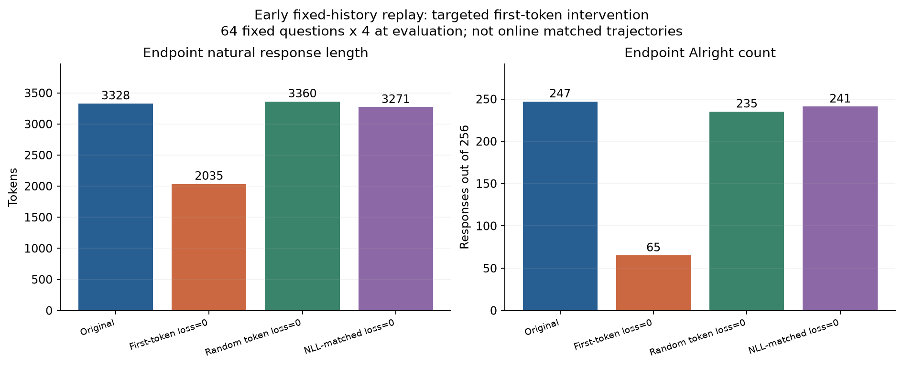
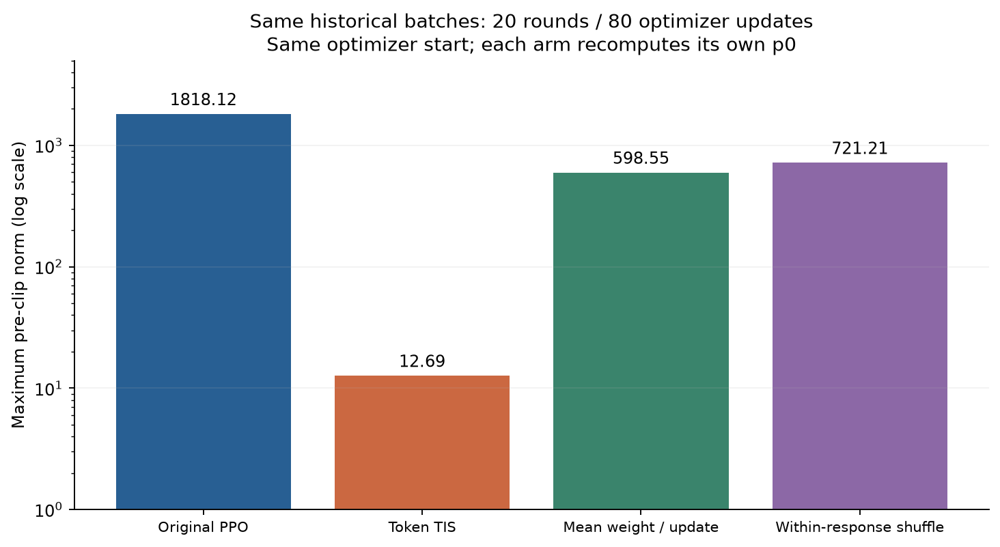
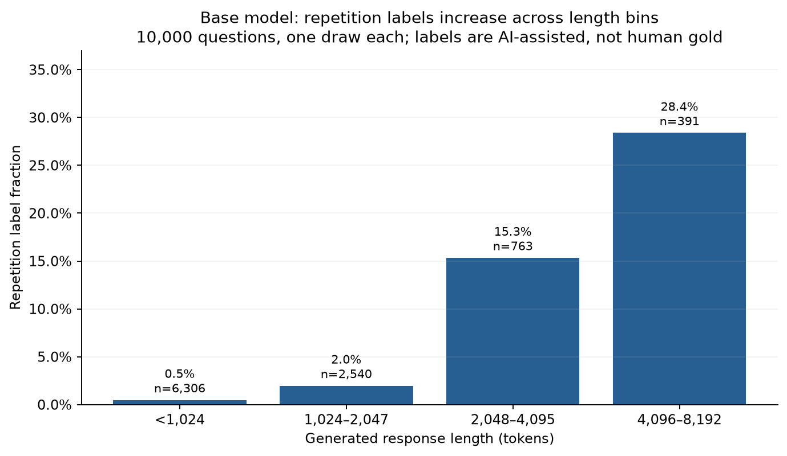

# RL 训练稳定性：把长度、梯度、概率失配和异常输出拆开

我们最初观察到输出突然变长，随后又遇到大梯度、训练与 rollout 概率不一致，以及乱码和机械重复。研究逐步转向干预验证。目前证据支持多个通道，尚未找到解释全部异常的单一根因。

**后续更新：** 650→850续训和两项反循环研究已经完成相应训练。本章保留早期研究叙述；完整后续证据、失败方案与修正请读[研究总报告](../reports/rl-length-gradient-investigation.md)。

## 先分清实验和指标

主要模型均为 **Qwen3-8B-Base**，数学答案奖励加超长惩罚，回答上限 8192，G8。但以下三条轨迹不能拼成同一次训练：[S01](../experiments/evidence.md#s01)

| 实验 | 用途 | 关键区别 |
|---|---|---|
| early formal/race4v2，约 1–200 轮 | 首 token 与早期长度跃升 | 八路同时生成，按先完成四条的结果做筛选 |
| late nodiscard44，500 起的分支 | 大梯度、TIS、旧回答重放 | 4+4 分阶段、不丢弃的 APRIL 续写路径；含重放和新 rollout 两类实验 |
| full8 eight，0–662 及后续续训 | 当前基础主线 | 完整八路并行，不做先四条筛选；APRIL 跨轮续写 |

`q` 是实际采样该 token 时 rollout 记录的概率；`p0` 是本轮更新前训练侧对同一 token 的重新评分；轮内更新后的概率另记为 `pθ`。`p0/q` 同时可能包含权重滞后、执行路径与精度差异，不等于只测跨轮陈旧程度。所有梯度范数均为**裁剪前**；原训练会裁剪到 1，再做 AdamW，因此范数放大一百倍不等于实际参数更新放大一百倍。

## 1. 早期长度跃升：开头模式确实有作用

这里的“首 token”指模型回答的第一个生成 token；`Alright`、`To` 是观察到的两类开头。早期 800 次优化器更新的最大梯度范数只有 **0.7069**。长度跃升发生时，训练侧与 rollout 的 PPL 也仍接近，因而这一段不需要用梯度爆炸解释。[S02](../experiments/evidence.md#s02)、[S09](../experiments/evidence.md#s09)

在同一历史训练 batch 流上重放，去掉每条回答首 token 的直接损失项，再对端点做 64 题×4 次自然生成：

| 重放方案 | 平均回答长度 | Alright 开头数 / 256 |
|---|---:|---:|
| 原损失 | 3328 | 247 |
| 首 token 损失置零 | 2035 | 65 |
| 随机一个 token 置零 | 3360 | 235 |
| 匹配 NLL 的一个 token 置零 | 3271 | 241 |

干预支持：**首 token 的直接学习信号驱动了这次早期转变的一部分**，不只是少训练一个 token。它不是强制把生成开头改成 To，也没有屏蔽正文梯度通过共享参数影响开头概率。端点评测使用相同引擎种子配置，并非逐请求配对随机数；重放也不等于在线重新采样训练。[S02](../experiments/evidence.md#s02)

为什么 RL 会偏向 Alright？在 Base 上固定同一 64 题，分别强制两类开头、各生成四次，正确率为 **57.8% vs 39.8%**，题目配对 bootstrap 的差值区间约为 **+10.5 至 +25.4 个百分点**。checkpoint 100、150 也保留了 Alright 的正确率优势。这是强制开头评测，不是自然采样的无偏质量排名。[S03](../experiments/evidence.md#s03)

实际 early 100–110 的训练数据中，Alright 尚少见，但正确率 68.0%、平均优势 `+0.447`；To 为 45.3%、`−0.0155`。这与“偶尔采到更有收益的模式，逐渐增加采样与学习机会”的正反馈解释一致。我们没有证明是某一次中奖更新独自触发跃升，也没有证明开头概率只由该 token 的优势决定。[S04](../experiments/evidence.md#s04)

后期另一条轨迹则出现信号反转：late 501–505，Alright/To 正确率约 **48.3%/60.1%**，平均优势 **−0.091/+0.142**。在同一记录回答上去掉长度惩罚并重算优势，Alright 仍为负，因此不能说“准确率收益不变，只是长度惩罚终于占优”。长度惩罚会增强已有劣势，内容和正确率也变了。不同轨迹的前后结果不能拼成已验证的周期振荡。[S04](../experiments/evidence.md#s04)

“方差更大所以更值得学”尚未成立。Base 的 G4 正误混合组比例与题内二元方差略高，但差值区间跨零；二元方差不是完整奖励方差，更不是参数梯度方差。有非零优势只说明产生信号，不能说明该模式受到正向鼓励。[S03](../experiments/evidence.md#s03)

## 2. Base 已有异常，但异常标签需要复核

在未经 RL 的 Base 上，按固定顺序选一万道不同题，每题自然生成一次，再用严格程序规则与全文 LLM 复核。2555 条被标异常、73 条不确定；其中重复标签 308 条，只有 **39 条**由严格程序规则直接确认。任务漂移、虚构对话、乱码、重复标签可以重叠；这是一份筛选语料，不是人工金标准，也不能把一次失败题目称为稳定诱发异常的题目。[S05](../experiments/evidence.md#s05)

已有 AI 辅助重复标签随回答长度增加：小于 1024 token 为 **0.48%**，1024–2047 为 **1.97%**，2048–4095 为 **15.3%**，4096–8192 为 **28.4%**。保守程序命中率也上升，但低得多。长度是生成之后的结果，循环本身会把回答拉长；这不能证明“长回答导致循环”。[S06](../experiments/evidence.md#s06)

为避免把正常数学推导误标为重复，我们盲审了八条特意选择的样例：**3 条明显循环、3 条轻度冗余、2 条正常推进**。新方法、新计算、不同 case 和有实质进展的自我修正不能仅因篇幅长就算循环。小样本揭示误报，不能估算总体标签准确率。[S06](../experiments/evidence.md#s06)

当前 full8 曲线另用保守机械规则：连续至少四个相同行/段、覆盖至少 500 字符和 320 非空白字符，或五次以上相同长句，或极端单字符重复；保留数字/公式差异并排除矩阵行等正常结构。它可作为一致的下限指标，但规则阴性不保证没有语义循环或乱码。[S13](../experiments/evidence.md#s13)

## 3. 某道题、某个 token，还是模型状态？

固定失败前缀和采样条件，对比 checkpoint 500/541：在选定的四条失败轨迹上，541 的异常边界续写 **32/32** 再次进入 `@` 循环，500 为 **0/32**。改用 FP16 没有救回 541；向前回退 128/512 token 会降低复发，单独替换第一个 `@` 则不够。这是选定前缀上的权重干预证据，不是总体异常率。[S07](../experiments/evidence.md#s07)

把 `@` 禁掉能消除该符号，却没有修复失败边界：541 的 32 次续写仍有 30 次到上限、零次答对，并出现其他重复。因此“屏蔽异常字符”不等于解决训练原因。六道诊断题的重采样显示题目、权重和生成路径相互作用；在四次循环里，大 log-prob 差都出现在首个 `@` 之后，至少这些案例不支持“先出现巨大概率差，再启动第一个循环字符”的统一顺序。[S07](../experiments/evidence.md#s07)、[S08](../experiments/evidence.md#s08)

PPL 还存在统计口径陷阱：记录的是每条回答 PPL 的算术平均，少数极值能支配整条曲线。late 548 的训练侧均值约 **2.1×10¹⁹**，中位数却约 **1.50**、95 分位约 **4.85**，前五条回答几乎贡献全部均值。必须同时查看序列均值 NLL、分位数、尾部占比和 token 位置，不能从总 PPL 判断“一个 token 爆了”。[S09](../experiments/evidence.md#s09)

## 4. 后期梯度：旧负优势回答和 token 权重对应关系

梯度可以写成 `Σ c_t ∇θ log pθ(a_t|prefix)`：`c_t` 汇总优势、PPO 比率与裁剪、mask 和归一化。大梯度既可能来自系数，也可能来自模型对固定输入的反向响应，或两者对齐。为分开这些因素，我们固定历史回答、组优势、顺序、分母和优化器起点做重放；各分支每轮重算自己的 `p0`。[S10](../experiments/evidence.md#s10)

TIS 在这里按 token 使用截断的重要性权重（上限 2）调节旧 rollout 信号。共同前十轮、40 次更新中，最大裁剪前范数为：原 PPO **33.95**、完整 TIS **7.52**、只校正负优势 **5.13**、只校正正优势 **61.56**。这支持负优势失配是该轨迹的重要放大通道，但不证明负优势更新本身有错，也不证明只校正负优势长期最好。[S10](../experiments/evidence.md#s10)

完整二十轮重放进一步比较：

| 方案 | 80 次更新的最大梯度范数 |
|---|---:|
| 原 PPO | 1818.12 |
| 正确对应到各 token 的 TIS | 12.69 |
| 每次更新内把权重换成统一均值 | 598.55 |
| 在各回答内部打乱权重位置 | 721.21 |

平均缩小权重或保留权重集合但打乱位置，都没有复现完整 TIS 的效果。这支持“哪些 token 被减权”很重要；PPO clipping、Adam 与后续轨迹仍会互动，不能把实验解释为纯学习率对照或一般收敛定理。新增均值/打乱分支没有语言质量端点评测。[S10](../experiments/evidence.md#s10)

另在一个重构峰值上做净梯度投影归因：最高 NLL、最高概率差的各 404 个 token 并没有贡献主要净梯度；低 `p0/q` 的大集合贡献约 59%。这反对“最大的几个离群 token 就足以解释峰值”的简单说法，但净投影允许抵消，也没删除前缀内容影响，不能排除更早的触发。[S11](../experiments/evidence.md#s11)

## 5. 模型状态也会让同一训练信号变得敏感

固定同八条旧回答与损失系数，只换参数，checkpoint 500/501/502/505/510 的范数约 **5.01/5.37/6.14/6.88/13.31**，重构的 517 轮内点为 **489.19**。输入和系数没变，说明参数状态本身改变了这一个方向的反向响应；不是测到了全局 Jacobian 范数。[S12](../experiments/evidence.md#s12)

上述参考是导出的 BF16 参数值转 FP32 执行。再读取真实 FP32 master，范数仍为 **340.91**：参数舍入确有影响，但不是这个点大响应的全部解释；这也不是完整 FP32 训练对照。[S12](../experiments/evidence.md#s12)

局部回退参数可明显改变响应：把 8–15 层退回 500，489.19 降至 **9.62**；只退这一段 MLP 为 **15.34**；回退 embedding 或 lm_head 仍约 488/484。实际反向流中，517 相对 500 的末层输出 hidden 梯度为 2.29 倍，首层输入为 285.42 倍。但 8–15 层局部反向增益并未相应增大，说明回退的作用还涉及前向状态和跨层交互。效果不可相加，也尚未验证修复后的质量。[S12](../experiments/evidence.md#s12)

## 6. 能压低梯度，不代表解决了训练质量

从共同 500 起点重新在线训练五十轮，原 APRIL 最大范数约 **1780.7**，从一开始启用 TIS 为 **1.35**；另一个同步新 G8 分支的二十轮最大值为 **0.63**。但各分支重新采样，回答和后续训练数据不同，不是同 batch 因果对照。[S14](../experiments/evidence.md#s14)

在固定 64 题×4、T=1 的端点评测，原配置与从 500 起 TIS 的正确数接近（137/134），AI 异常标签却为 **20/105**。原奖励也会给“含乱码但最终答案正确”的回答正优势。因此只降低梯度、PPL 差或重复字符并不足以保证回答质量；单次分支也不能证明 TIS 普遍损害质量。[S14](../experiments/evidence.md#s14)

## 7. 当前 full8 主线：长度与后期大梯度可以分离

固定 1021 道 DeepMath 题×4 的评测里，350→400 轮，Alright 从 **0.0245%→99.09%**，长度 **1422→2838**，正确率 **71.3%→74.3%**；351–400 的每轮平均梯度最大仅 **0.4075**。这符合开头切换伴随变长的观察，但 full8 尚未做首 token 损失干预。[S13](../experiments/evidence.md#s13)

600→650 则相反：评测长度 **1866→1377**，机械重复 **6/4084→1/4084**，每轮平均梯度 **0.658→77.276**。训练 batch 长度另有波动，不能拿固定评测长度代替入训长度。更早的 550→600，Alright 比例增加但其条件长度下降，也否定了“Alright 永远绑定固定长回答”的解释。[S13](../experiments/evidence.md#s13)

从完整650状态启动的 **650→850两百轮续训已完成**，累计800次更新。恢复得到的是新分支，未精确恢复活跃推理随机流与异步完成顺序，不能与原651–662拼成逐样本重演。后续的固定batch梯度干预、零版本滞后反例和反循环训练，已在[总报告](../reports/rl-length-gradient-investigation.md)与[新增实验记录](../experiments/stability-investigation.md)中整理。旧[S15](../experiments/evidence.md#s15)仅保留启动阶段快照。

## 聚合图表

两图分别属于早期与后期设置，不能拼成同一条训练轨迹。

已有AI辅助标签的描述统计，盲审发现边界误判，非人工总体循环率。

<!-- final-stability-progress:start -->
## 600→650逐组对照更新

[新的八组实验](../experiments/final-stability-600-650.md)当前纳入baseline、full TIS、negative TIS三组。两种TIS都抑制大梯度；negative TIS次要面板的初步正确率差为+3.91个百分点、区间[+0.20,+7.62]，但单轨迹、未校正多重比较与生成模式变化限制了结论。Full TIS的55,448条新完成候选已全量对账，其余候选文本统计尚有缺口。全部方法与统计齐全后再做总分析。
<!-- final-stability-progress:end -->
