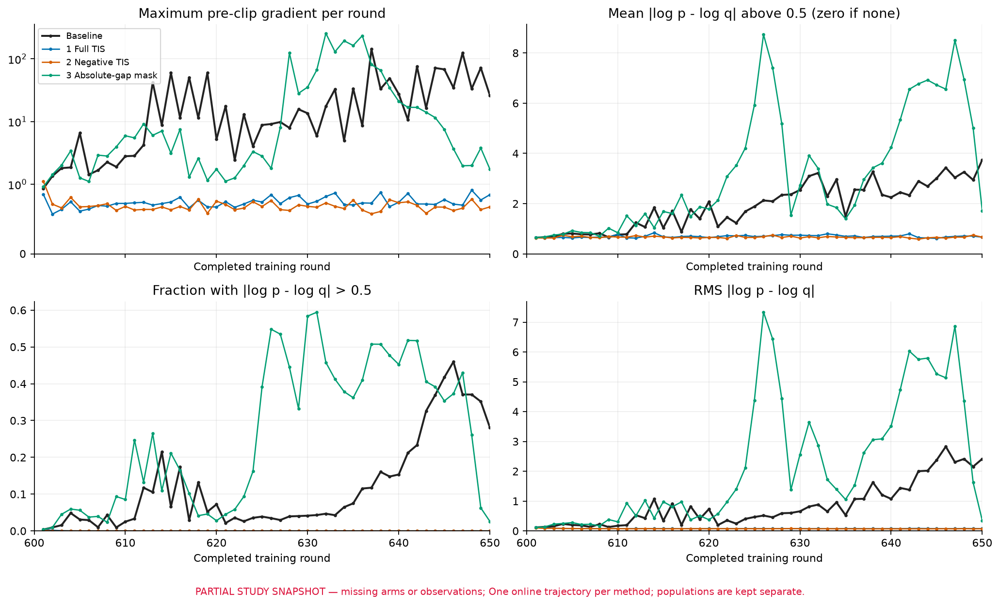
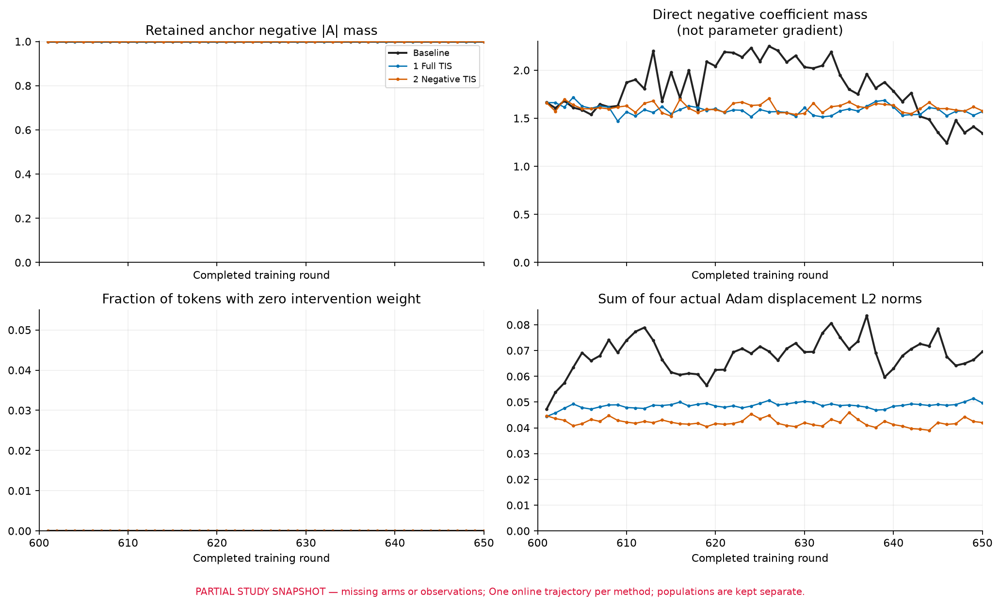
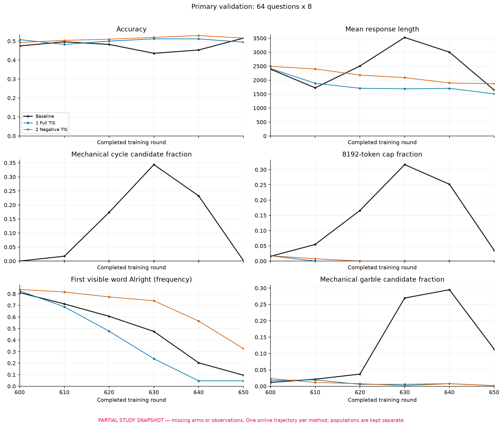
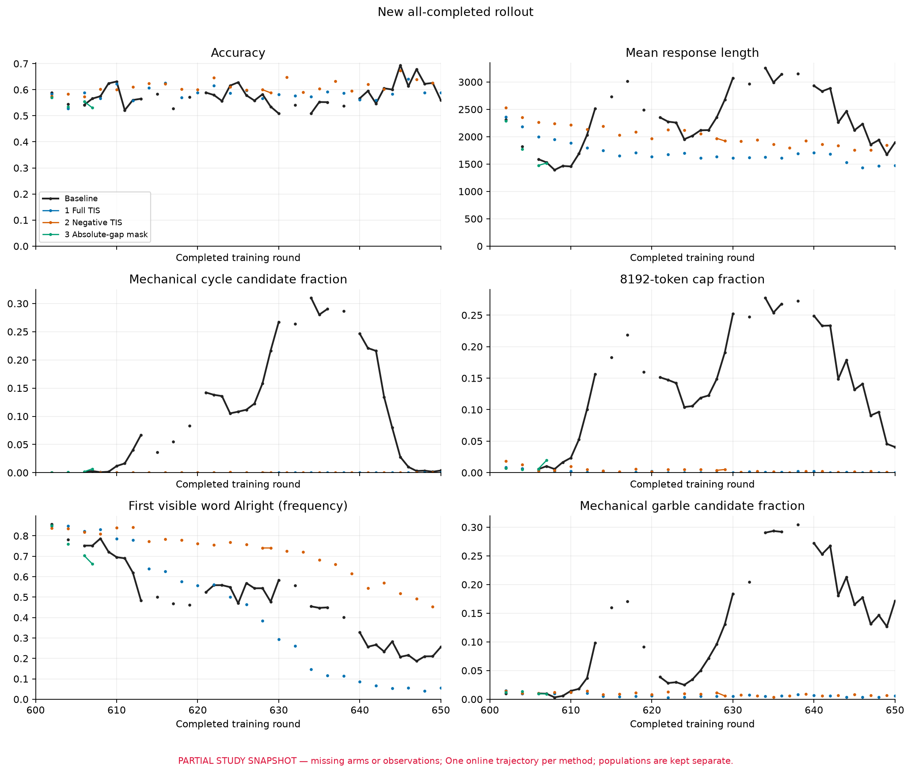
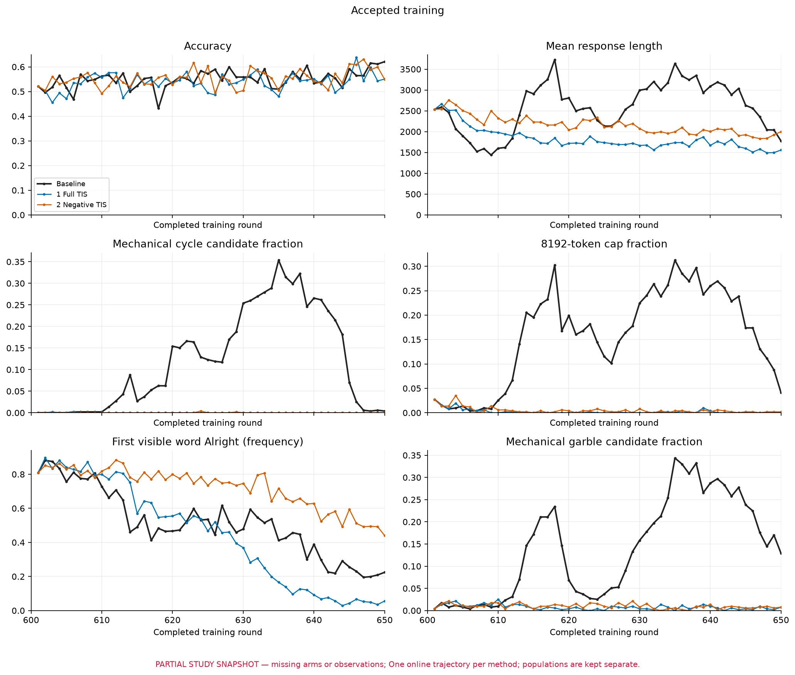

# 同一第 600 轮状态的八组在线干预

这是按组更新的研究记录。当前训练结果覆盖4/8组，次要评测覆盖5/9终点，已纳入四组的候选统计均为50/50轮，整个八组实验仍未完成；未纳入方法不当成零值或最终结论。

本轮要回答两个问题：降低 token 失配的训练权重，能否持续减轻后续梯度异常；只处理重复位置，能否保留这种收益，同时少干扰正常解题。每组从原 full8 主线同一个完整第 600 轮状态出发，训练至第 650 轮，各 50 轮、200 次 Adam 更新。八组是八种方法各一条在线轨迹，不是八次重复实验。

<!-- sixth-native-notice:start -->
原生训练已有6/8组完成，后两组尚未完成；第五、第六组次要评测与全量候选统计仍待补。见[第六组严格重复位置覆盖及六组训练曲线](../reports/rl-length-gradient-investigation.md#sixth-native-supplement)。前四组完整比较快照和五个次要端点保持原范围。
<!-- sixth-native-notice:end -->

## 共同设置与干预

模型为 Qwen3-8B-Base，每题 8 个回答，每轮收集 64 个按原准确率规则接受的组、512 个入训回答，再做四次各 128 个回答的全局更新。回答上限 8,192 token，学习率为 $5\times10^{-7}$，全局梯度裁剪阈值为 1。优化器是 AdamW，$\beta=(0.9,0.999)$、$\epsilon=10^{-8}$、weight decay 为 0.01；这些值从八个 rank 保存的 optimizer metadata 中核对。恢复 FP32 主参数、一二阶矩及第 2,400 次更新计数、scheduler 和已保存的随机状态；训练计算为 BF16。原始奖励、组优势、PPO clipping 与 dual clipping、有效 token 总分母和上下文均保留。

实际配置中，PPO 下/上裁剪宽度为 0.2/0.28，dual-clip 系数为 10；组优势为 $A_i=(R_i-\bar R)/(s_R+10^{-6})$，其中 $s_R$ 使用分母为 $G-1$ 的样本标准差。entropy 系数为 0，KL loss 关闭。原生 DAPO 先用本轮 actor 重算 `old_log_probs`，主 PPO 比值使用 $p_t/p_{0,t}$。下面的历史生成概率 $q_t$ 用于失配观测及相应干预，不能把 baseline 的主 PPO 比值写成 $p_t/q_t$。

原生 scorer 对正确回答给 $+1$，其余回答（包括 unknown）给 $-1$；二元准确率 `acc` 和 unknown 标记另行保留。奖励还包含长度软惩罚。令完整响应有效 token 数为 $L_i$，即响应区 attention mask 的和，包含续写前缀，则

$$R_i=\operatorname{score}_i+\min\left(-\frac{L_i-6144}{2048},0\right).$$

unknown 和达到长度上限的回答没有长度罚豁免。baseline 使用原响应 attention mask，没有额外屏蔽达到上限回答的 loss。APRIL 入组筛选读取独立的二元 `acc`：只有组内 `min(acc) != max(acc)` 才接受；全对、全错组均被滤掉。是否入组不由加上长度罚后的奖励方差决定。因此，“接受的组”“具有非零优势的组”“正确回答”“正优势回答”不能互换称呼。正确率统计始终读取 `acc`，不从加罚后的 reward 推断。

令 $q_t$ 为该 token 实际生成时保存的概率，$p_{0,t}$ 为本轮更新前 actor 对同一 token 的概率，$p_t$ 为实际第 B1–B4 次训练前向的概率。干预使用本轮固定、停止梯度的

$$s_{0,t}=\log p_{0,t}-\log q_t,$$

监测实际更新则使用 $s_t=\log p_t-\log q_t$ 和 $d_t=|s_t|$。负向阈值使用有符号的 $s_0$，不能写成非负的 $d_t<-0.5$。这里“正/负”指组优势 $A_i$ 的符号，不能直接替换成答对/答错。

| 方法 | 训练改动 |
|---|---|
| 0 · baseline | 原 APRIL full8 目标与收集流程 |
| 1 · full TIS | 所有有效 token 乘 $w_t=\min(\exp(\operatorname{clamp}(s_{0,t},-20,20)),2)$ |
| 2 · negative TIS | 仅 $A_i<0$ 的 token 乘上述 $w_t$，其余为 1 |
| 3 · absolute-gap mask | 当 $\lvert s_{0,t}\rvert>0.5$ 时，直接 loss 系数置零 |
| 4 · negative-down mask | 当 $A_i<0$ 且 $s_{0,t}<-0.5$ 时置零 |
| 5 · repeat-negative-down mask | 方法 4 再要求当前 token 属于预先确定的重复位置 $R_t$ |
| 6 · negative mass | 在原全局 128 回答 minibatch 内，对负优势回答按长度重分配权重，保持原负优势绝对质量 |
| 7 · sync fresh | 丢弃旧回答与其概率历史，按完整 G=8 重新生成；loss 使用 baseline 目标 |

方法 6 中，回答有效长度为 $T_i$，先取 $u_i=\min(1,2048/T_i)$，再在负优势回答中令

$$\lambda=\frac{\sum_{i:A_i<0}|A_i|T_i}{\sum_{i:A_i<0}|A_i|T_i u_i},\qquad w_i=\lambda u_i.$$

正优势与零优势回答保持权重 1；没有负优势 token 的 minibatch 不进行重分配。它守恒的是更新前 $|A|$ 加权的 token 质量，并不保证 PPO clipping 后的直接梯度系数质量或参数梯度范数守恒；短负回答的权重可能大于 1。

方法 1–2 使用 FP32 指数计算，并保留 $\exp(-20)$ 的数值下限；这与以前只有上限的 negative TIS 实现不完全相同，需报告下限命中数。方法 3–5 先将保存的 log probability 转为 FP64，再相减判断严格阈值。所有方法保留原有效 token 分母，不按剩余权重重新归一化。

重复位置 $R_t$ 由两种既有检测器取并集，算法在起跑前冻结：已被前缀确认的短周期重复，以及旧 512 字符窗口中的严格 noisy 4-gram 重复。它只读取文本和 token 对齐，不读取概率、奖励或优势，不使用未来后缀来决定当前 token 的 loss。检测仍是机械启发式，有误报和漏报可能。曲线中的“128 字符循环候选率”是另一个定义不同的观察指标，不能把它直接当成方法 5 的 loss 掩码覆盖率。

置零的是该位置的直接 loss 项。此 token 仍处在后续 token 的上下文中，不能据此声称它在整次反向中完全不贡献梯度。本轮没有额外 UL loss，也没有解码 repetition penalty。

## 观察人群与指标

三个来源分开统计：

1. **实际入训**：每轮最终接受的 512 个回答，包含各次 B1–B4 的真实前向和普通反向观测。
2. **当轮新完成的 rollout**：包含全对、全错及其他未进入训练的组，防止有效组筛选掩盖生成退化。
3. **新生成评估**：固定题集上的独立自然采样，不拼入训练轨迹。

训练记录裁剪前全局梯度范数、每次实际 FP32 主参数的 Adam 位移 L2、失配尾部和长度、优势符号、重复位置的分层指标。全局范数和全局 Adam 位移每次更新只记一次；token 的和先合并所有 rank/microbatch 后再算均值或 RMS。正负 token 的直接 loss 系数质量不是正负参数梯度范数，后者不能从前者直接推出。

失配尾部固定为 $d_t>0.5$，同时报告占比和条件均值；没有超阈值 token 时条件均值为 0，未测量的人群则为空值，不能填零。训练侧 PPL 定义为 $\exp(-\sum_t\log p_t/N)$，不采用逐 token 或逐回答 PPL 的算术平均。只有 rollout 的 $q$ 时可计算生成侧 NLL，但不能伪造缺少 actor 前向的 $d$。次要评估面板的 `log_PPL_q` 则先求每个回答的平均 NLL，再等权平均各题的四次回答，和训练侧全 token 加权指标分列。

## 两套评估

主要曲线在 600、610、620、630、640、650 轮评估同一组 64 道 DeepMath 题，每题采样 8 次。保留每个实验实际测得的第 600 轮点。对原生代码的审计发现它只有 replica 级 engine seed，没有最初协议所写的逐题逐次 request seed；这一偏差单独记录，训练启动后未修改运行配置。共享权重不意味着各组第 600 轮输出相同，题目可配对，回答随机数不能声称逐个配对。

另用排除上述 64 题后的固定 128 题面板，每题 4 个显式固定 request seed，比较公共第 600 轮与八个第 650 轮终点。面板含 78 道 DeepMath、42 道 MATH500、3 道 AIME24、4 道 AMC23、1 道 AIME25。它与主面板题目和执行设置不同，不能直接比较两面板原始正确率来估计训练收益。这两套题均来自训练期间使用过的 1,621 题评测集，不是从未使用的最终测试集。

次要面板另外以独立的 HF BF16/FA2 前向测 prompt 后的真实首 token 概率 $P(\text{Alright})$、$P(\text{To})$。自然生成使用 vLLM V1/native FlashInfer；这两个执行路径的结果分列，首 token 概率也与回答中实际首词频率分列。按题配对的 bootstrap 使用 10,000 次重采样、固定 seed 20261106；七种方法相对 baseline 的区间未作多重比较校正。区间来自题目重采样，条件于本批已经生成的回答与单条训练轨迹，不单独估计重新生成回答的波动，也不覆盖训练 seed 的不确定性。

## 解释边界

在线轨迹会因干预而改变后续收集到的题目、回答和异步完成顺序，因此方法差异包含后续数据分布变化。方法 7 还改变 collector、筛选与版本历史，不能只归因于去掉权重落后。

当前八组统一使用 vLLM V1 与显式 native FlashInfer/no-TRT 路径。旧第 600 轮来源日志中，8 个推理 worker 有 7 个记录过自动启用 TRTLLM prefill；没有逐 token 的旧后端路由证据。保留旧回答的组可能继续使用这种旧执行路径产生的历史 $q$，fresh 组同时去掉了这部分历史。当前 baseline 是统一实验环境中的对照，不是旧训练数值执行的逐位重放。

小梯度可能来自弱化了训练信号，裁剪与 Adam 状态也会改变梯度范数和实际参数位移的关系。最终判断需共同查看准确率、循环候选率、截断率、长度和实际参数更新；不能单凭峰值下降宣称修复了解题或重复。

各组使用同一套 16 CPU worker 的文本观测。某些 Unicode/token 边界需要逐前缀解码，长回答可能产生很高的 CPU 检测耗时，因此本次总训练用时包含明显的观测开销，不是各方法优化后的纯训练吞吐。该检测耗时已经包含在原生 actor-update 计时中，不能再加一次。

## 已完成组结果（逐组更新）

### 同一600状态的八组对照（逐组更新）

发布组装于 **2026-11-06 10:01 UTC**，训练统计冻结于 **2026-11-06 09:51 UTC**。当前纳入 **4/8组训练、5/9个次要评测端点**，计划八组各从600训练到650、各50轮200次更新；其余四组尚未纳入本快照。这是逐组快照，不是八组最终排名。

| 方法 | 更新数 | 最大裁剪前梯度 (轮/B) | 梯度均值 | >1 / >10次数 | 每次Adam位移L2均值 |
|---|---:|---:|---:|---:|---:|
| 0 Baseline | 200 | 142.31274 (637/B2) | 9.38013 | 110 / 41 | 0.01704655 |
| 1 Full TIS | 200 | 0.91467 (648/B4) | 0.65604 | 0 / 0 | 0.01216131 |
| 2 Negative TIS | 200 | 1.11361 (601/B3) | 0.60338 | 1 / 0 | 0.01053159 |
| 3 Absolute-gap mask | 200 | 254.56696 (632/B3) | 11.58777 | 98 / 30 | 0.01792930 |

实际Adam位移是200次参数更新L2范数的平均，不是600→650净位移。裁剪前梯度不能代替实际更新大小。

| 方法 | d>0.5占比 | 超阈值条件均值 (nats) | d RMS (nats) | 有效token |
|---|---:|---:|---:|---:|
| 0 Baseline | 12.226775% | 2.53503 | 1.14208 | 66,078,485 |
| 1 Full TIS | 0.025859% | 0.66795 | 0.07940 | 46,783,649 |
| 2 Negative TIS | 0.009157% | 0.65575 | 0.07416 | 55,355,157 |
| 3 Absolute-gap mask | 27.862756% | 4.10593 | 3.07529 | 65,340,492 |

$d_t=|\log p_t-\log q_t|$；先合并实际入训有效token再计算占比、RMS和超阈值条件均值，没有超阈值token时条件均值为0。缺失观测为空，不填零。这不是逐轮均值的平均，也不是相同数据上仅改loss的静态比较。



| 权重/方法 | 主面板600 | 主面板650 | 次要面板正确率 | 平均长度 | 循环/乱码候选/截断数 (各512条) | HF P(Alright)/P(To) |
|---|---:|---:|---:|---:|---:|---:|
| 公共600 | — | — | 69.34% (355/512) | 1961.32 | 0 / 3 / 4 | 83.34% / 12.72% |
| 0 Baseline | 47.46% | 51.56% | 66.99% (343/512) | 1335.47 | 1 / 31 / 9 | 17.35% / 69.26% |
| 1 Full TIS | 50.78% | 49.41% | 63.28% (324/512) | 1355.89 | 0 / 3 / 1 | 6.75% / 82.97% |
| 2 Negative TIS | 49.22% | 51.56% | 70.90% (363/512) | 1557.02 | 0 / 1 / 1 | 36.25% / 40.87% |
| 3 Absolute-gap mask | 49.80% | 53.12% | 69.73% (357/512) | 972.32 | 0 / 49 / 0 | 3.17% / 79.27% |

主面板为64题×8，次要面板为另外128题×4，题目与执行设置不同，不直接比较两面板原始正确率。公共600行只列次要面板，不把任一组原生600评测冒充公共值。HF提示词首token概率与vLLM实际首词频率分别记录；循环与乱码是机械候选标签，不是语义人工判定。Unknown回答保留在原分母中。

| 方法 | 相对baseline650 (百分点) | 相对公共600 (百分点) |
|---|---:|---:|
| 1 Full TIS | -3.71 [-8.01, +0.59] | -6.05 [-9.77, -2.34] |
| 2 Negative TIS | +3.91 [+0.20, +7.62] | +1.56 [-1.95, +5.08] |
| 3 Absolute-gap mask | +2.73 [-0.59, +6.25] | +0.39 [-3.32, +4.10] |

表中为正确率差及95%区间，128题配对bootstrap 10,000次、seed 20261106。区间条件于已生成回答和每方法单条训练轨迹；七种方法比较未作多重校正，不自动构成方法排名或跨seed结论。




| 方法 | 50轮原生步骤累计 (分钟) | 其中CPU文本观测 (分钟) |
|---|---:|---:|
| 0 Baseline | 213.04 | 127.43 |
| 1 Full TIS | 75.51 | 20.53 |
| 2 Negative TIS | 97.31 | 35.17 |
| 3 Absolute-gap mask | 231.99 | 148.31 |

CPU文本观测已经包含在原生步骤计时中，不能重复相加；两列之差只是计时拆分，不能当作实测的无观测吞吐。训练后全量候选离线统计耗时另计，当前总时长也不是各方法优化后的纯训练速度。

#### 经审定的讨论

本次只补齐 **Absolute-gap mask 的全部50轮候选统计**。已纳入四组的800次训练更新、24次主评测和五个次要端点均沿用此前结果，没有新增训练或评测采样。四组候选统计现已全部覆盖601–650；其余四种方法尚未纳入本快照，仍不能给出八组最终排名。

两种TIS在各自轨迹上均抑制了大梯度；按更新前失配做硬屏蔽的Absolute-gap mask没有避免中途爆发。它的最大裁剪前梯度为254.57，超过100的更新有7次；baseline分别为142.31和2次。不过它超过10的更新为30次，少于baseline的41次，因此不能简化为“所有尺度上都更差”。完整分布、实际Adam位移和最终解题表现应一起看。

这不是屏蔽未执行。四组的[实际训练核验摘要](../data/final-stability-600-650/completed_four_arm_native_audit.json)显示，Absolute-gap mask在65,340,492个有效token使用位置中将16,345,831个权重置零（25.0164%）；其中正优势1,344,913个、负优势14,878,933个、零优势121,985个。所有被屏蔽位置的实际直接系数 $\partial L/\partial\log p_t$ 都为0。这里的正负是优势符号，不等于答对或答错；直接系数为0也不意味着该位置作为上下文的间接参数梯度消失。

要区分筛选时和训练时的概率：屏蔽使用每轮开始前固定的 $s_{0,t}=\log p_{0,t}-\log q_t$，条件为 $|s_{0,t}|>0.5$；图中则统计每次真实前向的 $d_t=|\log p_t-\log q_t|$。随着同轮四次更新推进，$p_t$可以变化。该组全有效入训token的 $d_t>0.5$ 占比为27.8628%，尾部条件均值4.10593 nats、RMS 3.07529 nats；**这些统计包含已经屏蔽的位置**，不能读成“剩余直接loss位置仍有这么多失配”。

[第628轮的有界核查](../data/final-stability-600-650/abs_gap_mask_round628_anchor_current.json)提供了更具体的证据。B2当时的梯度范数为123.60，保留365,962个位置；利用互不重叠的rank、microbatch及优势/重复分组充分统计，可以保证至少40,904个保留位置在当前前向中出现 $d_t>0.5$，上界为244,667；其中至少77个有非零直接loss系数。B3相应下界为25,875个，至少16个系数非零。这些是计数界，不是逐token精确定位，也没有分解它们对参数梯度的贡献；它们说明固定筛选集合不能保证后续前向仍满足同一阈值，不能证明这些位置解释了全部峰值。同轮B1–B4还使用不同的128条回答，不能只按更新编号做因果归因。

该组后期恢复了较短的回答，但输出质量仍需分别看。主面板630轮只有2条循环候选，却有207条乱码候选、174条触顶；650轮循环与触顶都为0，乱码候选仍有75/512。对630轮少量定向样本的私下核查确实看到正常数学开头随后变成混杂词片，也看到未触顶的退化回答；这不是总体误报率估计，原始问答不在本次发布中。循环、严格重复和乱码标签定义不同，低循环率不能替代其他质量指标。

固定次要面板上，Absolute-gap mask为357/512（69.73%），相对baseline高2.73个百分点，95%区间[−0.59,+6.25]；相对公共600高0.39个百分点，区间[−3.32,+4.10]。平均长度972.32 token，循环候选0、乱码候选49、触顶0。它既未避免中途梯度峰值，现有单轨迹评测也不足以证明准确率改善。

前两种TIS的解释保持原有限制：Negative TIS相对baseline为+3.91个百分点，区间[+0.20,+7.62]；相对公共600为+1.56个百分点，区间[−1.95,+5.08]。Full TIS相对baseline为−3.71个百分点，区间[−8.01,+0.59]。这些区间条件于已生成回答和各自单条训练轨迹，七种比较未作多重校正；不能称Negative TIS为稳定赢家，也不能把小梯度直接等同于更好的解题能力。四组首个601 batch的原始输入、优势和概率张量一致，后续在线数据已经分叉。

四组的全量新完成训练候选现已齐全。下面均为各自50轮累计候选，包含全对、全错和混合组；不是固定checkpoint、相同题目的配对评测。

| 候选人群 | 回答数 | 循环候选 | 严格重复并集 | 乱码候选 | 触顶 | token加权log PPL（nats） |
|---|---:|---:|---:|---:|---:|---:|
| Baseline | 53,168 | 5,750 | 5,187 | 6,546 | 7,357 | 2.21206 |
| Full TIS | 55,448 | 4 | 8 | 370 | 82 | 1.96304 |
| Negative TIS | 53,760 | 6 | 10 | 491 | 222 | 1.90280 |
| Absolute-gap mask | 52,192 | 2,587 | 2,021 | 8,521 | 6,983 | 2.95514 |

Absolute-gap mask的累计循环候选比例为4.9567%，低于baseline的10.8148%；乱码候选比例却为16.3263%，高于baseline的12.3119%。该组触顶比例13.3794%，平均长度2287.13 token。这些不同方向的变化再次说明，循环检测率不能替代整体输出质量；不能据此证明循环转化成了乱码，也不能把这一非配对比较当作对两者因果关系的验证。

标签可以重叠，不能相加为“总异常数”。按表中四组顺序，候选答对比例分别为57.29%、58.57%、61.17%、56.25%；方法改变了生成、长度、完成顺序和训练选择，这些比例不能替代固定面板正确率。所选token的生成概率 $q\geq0.999$ 占比分别为24.3204%、4.4018%、5.0843%、14.1609%；token NLL RMS分别为3.91712、2.99401、2.94874、4.58930 nats。平均NLL、RMS和高置信度token占比描述分布的不同方面，不是全词表熵，也不能单凭它们确定因果。候选人群只保存生成侧$q$，未重测actor $p$，不补造候选$d_t$。

四组的入训来源均已对账：每组25,600条入训使用中，24,984条匹配本窗口新完成候选的原group及prompt/response token身份，42项纯文本统计一致；另616条恰好来自原600 ready池的77组×8，601轮使用512条、602轮使用104条。没有无法解释的缺口，也不意味着全部新完成回答的前缀均在本窗口生成。这里只核已有行统计与可用mask计数，没有重算完整token mask。原始聚合见[Baseline](../data/final-stability-600-650/baseline_candidate_closure.json)、[Full TIS](../data/final-stability-600-650/full_tis_candidate_closure.json)、[Negative TIS](../data/final-stability-600-650/negative_tis_candidate_closure.json)和[Absolute-gap mask候选对账](../data/final-stability-600-650/abs_gap_mask_candidate_closure.json)。



实际入训图中的actor与历史rollout两条log PPL均为有效token加权平均NLL；actor $p$来自B1–B4实际前向，历史$q$来自同一批token的生成记录，没有对逐token PPL作算术平均。



第四组52,192条候选中，24,984条复用了同一臂已核验的入训纯文本统计，27,208条由原检测程序计算；这次收尾核对没有重新执行检测器或模型。全部缓存命中的1,049,328项纯字段、6,524个原始group的身份、119,370,002个原$q$ token及版本年龄均完成独立来源核验；缓存命中不称作独立重新检测，也未把入训的actor概率移植给候选。该组新完成而未在窗口内入训的27,208条，按全对15,608条、全错11,448条、混合152条（19组）核对，无未解释缺口。

各组离线资源、分块、等待和复用路径不同，不比较离线吞吐。线上四组仍沿用固定的16个文本观测worker；CPU观测时间包含在原生步骤时间内，不能重复相加或把扣除后的时间当作实测无观测吞吐。

#### 候选统计覆盖与对账

此冻结快照的全量新完成rollout文本统计覆盖：**0 Baseline 50/50轮；1 Full TIS 50/50轮；2 Negative TIS 50/50轮；3 Absolute-gap mask 50/50轮**。它与实际入训、固定题目评估分开；这些覆盖范围不代表实时服务器进度。空轮没有回答时相关均值为空；曲线保留断点并画出孤立有效点。

保留的[Full TIS候选对账](../data/final-stability-600-650/full_tis_candidate_closure.json)共6,931组、55,448条新完成训练候选，归一化128字符循环候选4条、严格重复并集8条、乱码候选370条、触顶82条。它是跨轮累计训练候选，包含全对/全错组，不是固定checkpoint测试集。

Full TIS入训25,600条中，24,984条匹配窗口内新完成候选；其余616条=77组×8与原600 ready池按原token身份多重集合直接核对。已有42项纯文本统计一致，不代表完整token mask逐项复算。新完成候选也可能继承旧前缀；候选人群只记录生成侧$q$，未重测actor$p$，不能据此给出候选$d_t$。

最早baseline观测器尝试在602轮因退役segment缺字段报错，修复后正式组均从原600起跑；失败尝试未纳入结果，没有按梯度或准确率择优重跑，训练算法没有因该观测器修复改变。原生主评测只固定engine seed，不声称逐请求随机数配对。后续在线数据轨迹会分叉；sync fresh还会改变收集流程及旧概率历史，不能只归因于权重落后。所有八组与统计齐全后才运行最终验收。

## 数据与复核

[训练与统计状态](../data/final-stability-600-650/training/summary.json)、[次要评测状态](../data/final-stability-600-650/secondary/summary.json)、[发布清单](../data/final-stability-600-650/manifest.json)保留明确的未完成状态。原始回答、逐token数组和模型权重未公开；CSV包括实际更新、正负优势/重复分层、候选输出、验证和原生计时。

```bash
python tools/check_final_stability_progress.py
python tools/render_final_training.py --allow-partial
python tools/plot_secondary_aggregates.py --data-dir data/final-stability-600-650/secondary --output figures/final-stability-secondary-redraw --allow-partial
```

两套重绘程序仅使用聚合CSV。当前重绘须标明partial；所有八组与全部统计完成后，再运行严格的 `tools/check_final_stability.py`。便携损失与检测核心见[参考实现](../reference/stability/README.md)。
