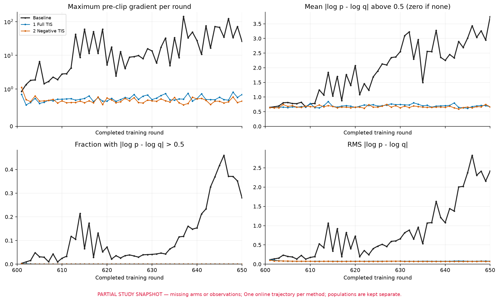
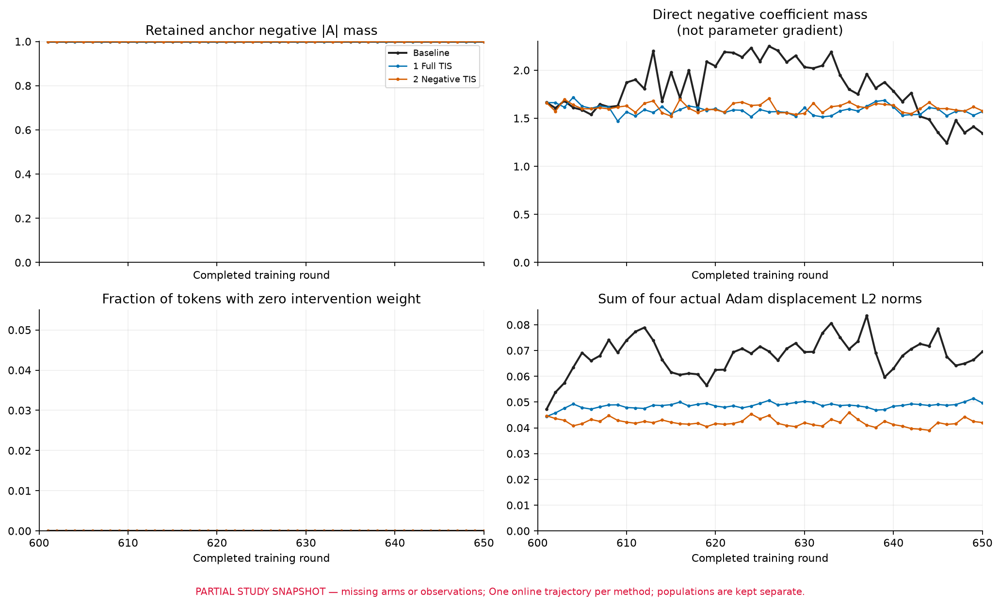
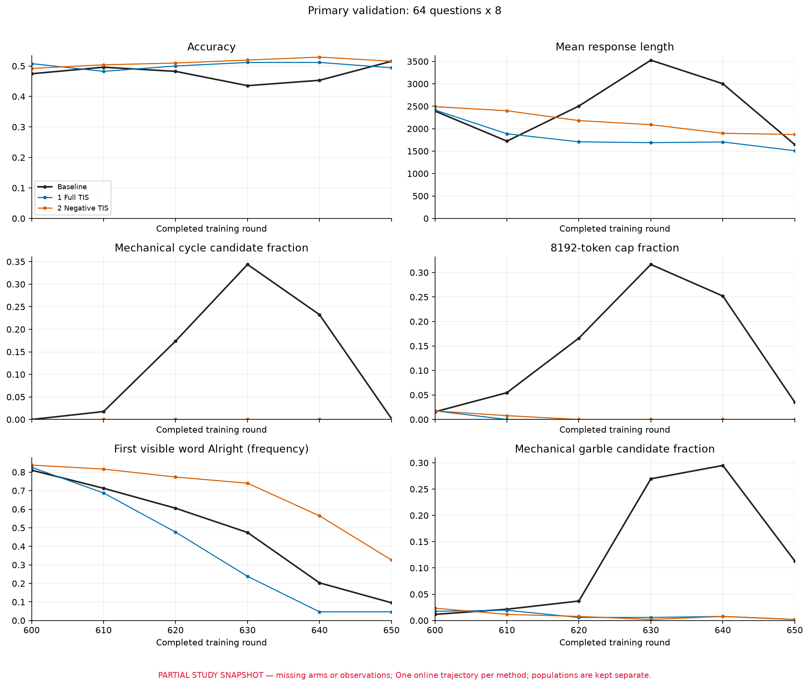

# 稳定性研究状态：2026-11-06

full8续训650→850已经完成。720固定E-only UL研究已完成五阶段合计50轮训练；四个优先端点自然评测已完成，其他中间节点不在本报告中声称完成。600在线bank UL已完成600→620的20轮、80次更新以及600/610/620验证。

600短训实际使用76条唯一辅助回答、73题，303轨迹条次、9032目标token条次，48/80次更新有非零辅助分量。主RL回答使用10240条次，与独立bank的条次不能计算成“其中多少条”的子集比例。

最新短训循环候选从0/512增到117/512、正确率从51.17%降到44.53%；缺少匹配baseline，不构成成功预防证据，也不能判定UL导致全部退化。历史720试验的baseline端点也优于UL端点。

[总报告](../reports/rl-length-gradient-investigation.md)保留观察、干预支持、待证猜想、反例与后端混淆。该文件是带日期的研究快照，不是持续轮询的实时监控。

<!-- final-stability-progress:start -->
### 同一600状态的八组对照（逐组更新）

本次发布组装于 **2026-11-06 04:08 UTC**，使用2026-11-06 03:48 UTC冻结的训练统计快照。计划为baseline加七种方法，各训练600→650的50轮、200次更新。当前纳入 **baseline、full TIS、negative TIS三组（3/8）**；次要评测已完成公共600和三个650终点（4/9）。这不是八组最终排名。方法和原始聚合表见[实验记录](../experiments/final-stability-600-650.md)。

| 指标 | Baseline | Full TIS | Negative TIS |
|---|---:|---:|---:|
| 实际更新次数 | 200 | 200 | 200 |
| 裁剪前梯度最大值 | 142.313（637轮B2） | 0.915（648轮B4） | 1.114（601轮B3） |
| 裁剪前梯度均值 | 9.380 | 0.656 | 0.603 |
| 梯度 >1 / >10 的更新数 | 110 / 41 | 0 / 0 | 1 / 0 |
| 每次实际Adam位移L2的均值 | 0.01705 | 0.01216 | 0.01053 |
| 主评测650正确率，64题×8 | 51.56% | 49.41% | 51.56% |
| 次要评测650正确率，128题×4 | 66.99%（343/512） | 63.28%（324/512） | 70.90%（363/512） |
| 次要评测平均回答长度 | 1335.47 | 1355.89 | 1557.02 |
| 次要评测循环候选数 / 截断数（各512条） | 1 / 9 | 0 / 1 | 0 / 1 |
| HF提示词首token P(Alright) / P(To) | 17.35% / 69.26% | 6.75% / 82.97% | 36.25% / 40.87% |

在这条轨迹上，两种TIS都抑制了大梯度。Negative TIS的精确峰值为 **1.11361**，200次更新只有一次超过1；full TIS的峰值为0.91467。Negative TIS相对baseline的次要面板正确率差为 **+3.91个百分点，95%区间[+0.20,+7.62]**；full TIS为 **−3.71个百分点，区间[−8.01,+0.59]**。公共600权重在同一次要面板为69.34%；negative TIS相对它为 **+1.56个百分点，区间[−1.95,+5.08]**。

这些区间由128道题配对、10,000次bootstrap（seed 20261106）得到，条件是这批已生成回答与每种方法的一条训练轨迹；七种方法的比较未作多重校正，不能据此称negative TIS为稳定赢家，也不能证明只修正负优势在其他训练中普遍优于full TIS。Negative TIS的回答比baseline平均长221.54 token，区间[108.72,332.15]；两者开头模式也明显不同。因此，小梯度并不意味着生成行为保持不变。表中HF提示词首token概率来自独立HF BF16/FA2探针，与vLLM自然生成的首词频率分别记录。

实际入训token的 $d_t=|\log p_t-\log q_t|$ 统计如下，合并全部有效token后计算；尾部均值只在 $d_t>0.5$ 的token上取均值，不能与每轮均值的平均混用。

| 入训token统计 | Baseline | Full TIS | Negative TIS |
|---|---:|---:|---:|
| $d_t>0.5$ 占比 | 12.2268% | 0.025859% | 0.009157% |
| 超阈值token的条件均值，nats | 2.53503 | 0.66795 | 0.65575 |
| $d_t$ RMS，nats | 1.14208 | 0.07940 | 0.07416 |

最早的baseline观测器尝试在602轮因退役segment缺少字段而报错。修复观测器后，正式baseline及各方法均从原600状态起跑；失败尝试没有纳入结果，也没有按梯度或准确率择优重跑。该故障修复没有改变训练算法，重启前后首个601轮的四次更新已有一致性核对。

三组首个601训练batch的原始输入、优势与概率张量相同，后续在线采样轨迹则已不同。上表描述各自实际入训分布，不能当成相同数据上仅修改loss的静态对照，也不能单凭关联证明失配下降的唯一中介。

裁剪前峰值的差距远大于实际Adam位移均值的差距：三组每次更新L2均值分别为0.01704655、0.01216131、0.01053159。这是200次位移范数的平均，不是600→650净位移。TIS权重接近1的微小数值变化也会计入“changed token”，不能将这个计数当成受实质干扰的正常token数。

主评测64题都是DeepMath，次要128题包含DeepMath、Math500、AIME和AMC，且题目集合互不重叠，不能直接比较两面板正确率。主面板的600初值分别为47.46%、50.78%、49.22%，源权重相同，但原生采样只固定engine seed，没有逐请求固定随机数；保留这些实际观测，不把初值差归因于干预。当前baseline没有额外UL，也出现了循环候选从600轮0/512升至630轮176/512、再降至650轮1/512的过程。早先600→620 UL轨迹的恶化仍不构成预防成功，但跨轨迹比较也不能证明UL造成退化。

同步文本检测带来了明显观测开销：baseline的50轮原生步骤累计213.04分钟，其中CPU检测127.43分钟；full TIS为75.51/20.53分钟，negative TIS为97.31/35.17分钟。CPU项已包含在步骤计时中，不能重复相加；扣除它也只是计时拆分，不是实测无监控速度。Unicode边界可能触发逐前缀解码与归一化慢路径，这批总耗时不能直接当成优化后的方法吞吐比较。训练后全量rollout统计的耗时另计。

#### Full TIS：全量候选输出与入训数据的对账

Full TIS的601–650轮全量新完成候选已统计完毕：[候选与继承来源汇总](../data/final-stability-600-650/full_tis_candidate_closure.json)。共 **6,931组、55,448条回答、94,949,943个token**，其中32,478条答对（58.57%），平均长度1712.41。它们是训练期间跨轮、跨权重累计的候选，包含all-wrong和all-correct组，**不是测试集，也不是某个固定checkpoint的准确率**。

机械检测给出的归一化128字符循环候选只有 **4条（均为other类型）**；严格noisy检测与exact∪noisy严格并集均为8条，乱码候选370条，达到8192上限82条。不同检测器不是同一标签，不能把“4条循环”解释为全部异常只有4条，也不能把乱码候选当成人工确认的乱码。

| 全量候选分组 | 组数 | 回答数 |
|---|---:|---:|
| mixed | 3,203 | 25,624 |
| all-correct | 2,335 | 18,680 |
| all-wrong | 1,393 | 11,144 |

实际入训25,600条中，**24,984条**可按group身份和原prompt/response token字节SHA匹配本窗口的新完成候选，42项纯文本统计全部一致。其余 **616条=77组×8**，已与原600状态的ready池逐条、多重集合核对：601轮使用512条，602轮使用104条。这些回答在600就已经完成，因此不应出现在601–650的新完成清单中；没有额外未解释的缺口。新完成mixed候选还有640条（80组）未在本窗口入训。这里的匹配只验证已有行统计与可用mask计数，没有重算检测器，也不证明完整token mask位置逐项相同。

候选中12,749条（22.99%）跨权重生成；“新完成”也可能包含从600继承的未完成前缀，并非每个token都是本窗口新生成。保存的rollout $q$ 覆盖全部候选token，token加权log PPL为1.96304 nats（PPL 7.12095）。此候选汇总没有重新测actor $p$，因此没有候选人群的 $d_t$，不能把入训失配曲线移植到这里。

本快照三组的训练/入训观测与六个主评测点均完整；**全量新完成rollout文本统计只覆盖baseline的601–627（27/50轮）、full TIS的50/50轮，negative TIS为0/50轮**。缺失不填零，这部分曲线尚不能用于三组完整轨迹比较；当前快照也不声称这些范围代表实时服务器进度。八组全部结果与候选统计齐全后再做总分析。
<!-- final-stability-progress:end -->
