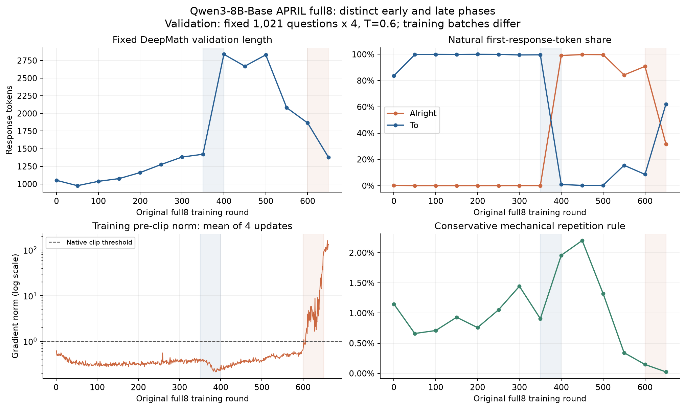
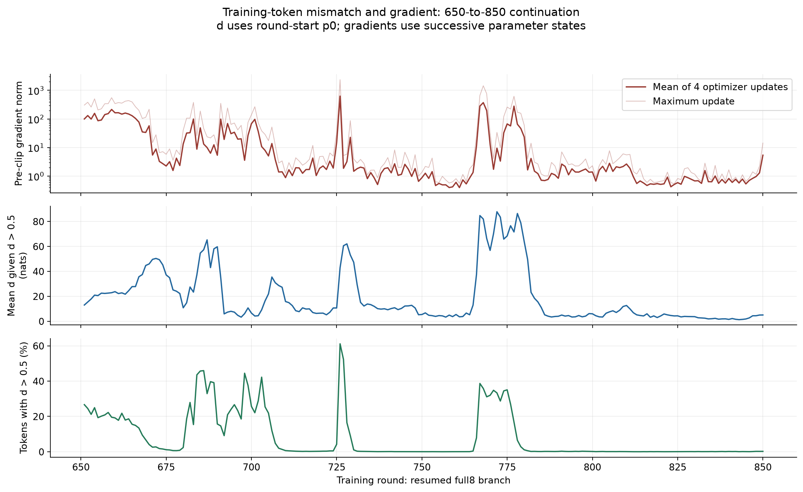
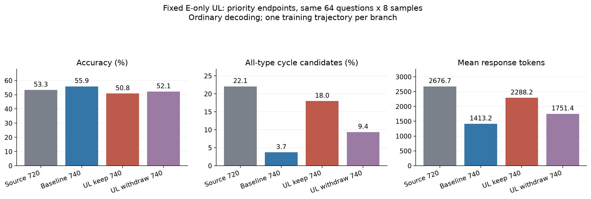
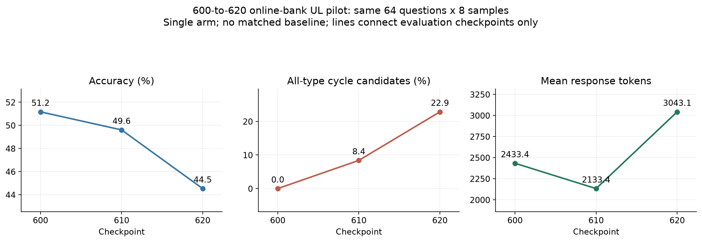
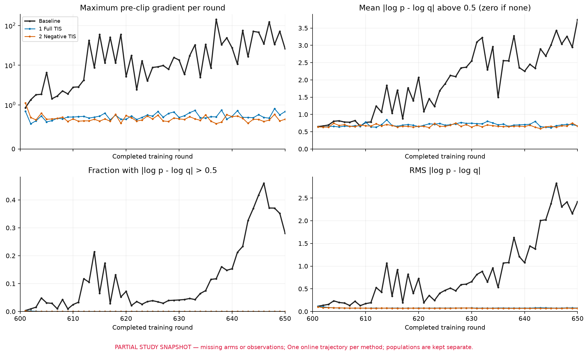
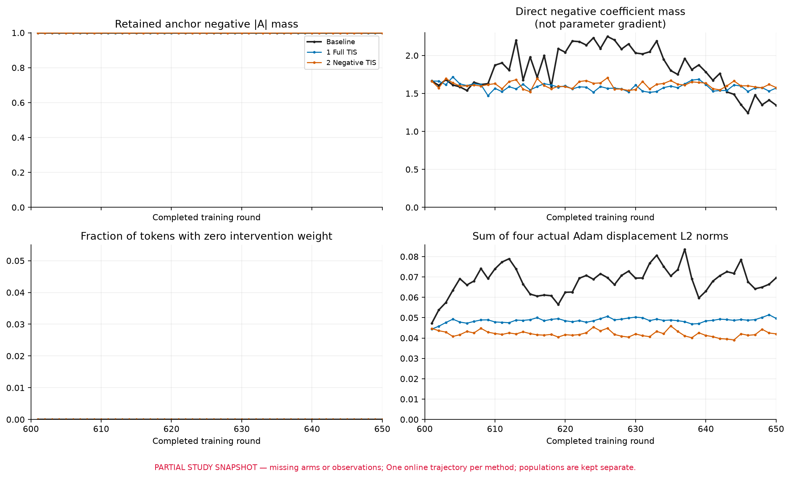
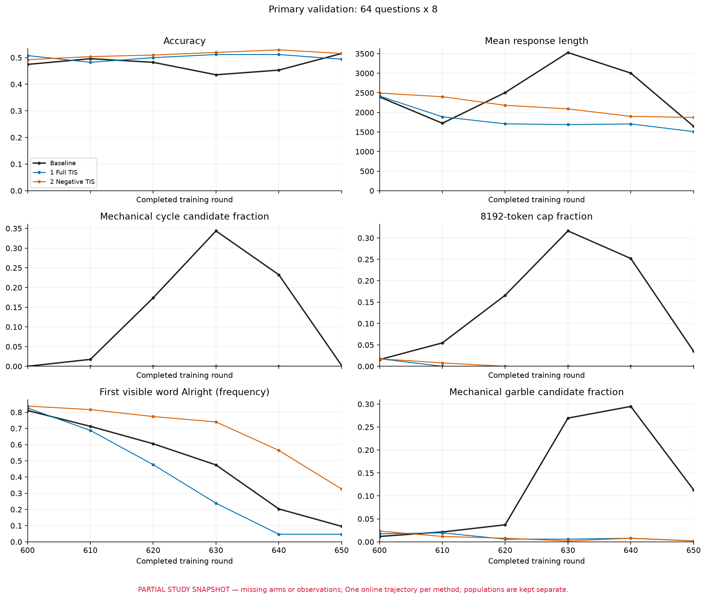

# 从输出长度跃升到梯度异常：数学 RL 的实验、解释与干预

研究报告，更新至北京时间 **2026-11-06**。范围：从 BBB 上发现 Qwen3-8B-Base 的输出长度突然增长，到 full8 后期梯度诊断、循环机制探针，以及最新完成的 600→620 反重复短训。本文记录本项目的证据，不将局部干预写成一般定理，也不将工程验证写成训练有效性。

[项目首页](../README.md) · [逐项实验记录](../experiments/stability-investigation.md) · [指标定义](../docs/measurement-guide.md) · [参考实现](../reference/antiloop/README.md)

阅读顺序：[早期长度与开头](#early-length) → [数据与Base](#base-data) → [PPL与后期梯度](#late-gradient) → [失配和受控干预](#gradient-controls) → [循环机制](#loop-mechanisms) → [尝试的修复](#interventions) → [结论修正](#revisions)。

## 1. 现在能够回答什么

我们最初想解释一个现象：数学 RL 训练中，输出长度会在很短的区间内明显跃升。后续发现，**早期变长、后期大梯度、推理与训练概率失配、持续循环，是相互联系但可以分离的现象**。

目前支持最强的结论有四项：

1. **早期长度跃升有一个已做干预的驱动：回答开头模式的学习。** 在一条早期实验中，单独去掉首个生成 token 的直接损失，会显著削弱 To→Alright 的切换和变长；随机 token 与匹配 NLL 的对照没有同样效果。其他主线也观察到相似切换，但不能把这一次干预直接视为所有设置中的因果证明。
2. **后期梯度放大取决于输入、损失系数和模型状态的共同作用。** 旧负优势回答、与 token 正确对应的权重、训练/生成失配都能影响梯度。相同回答在不同 checkpoint 上的反向响应也能相差很大。大 $d_t$ 是重要诊断和干预定位信号，不是单独决定梯度范数的充分条件。
3. **持续循环与严重失配在部分模型状态下高度绑定，但并非等价。** 有正常文本失配的反例，也有长循环但失配较小的反例；同权重、没有跨轮滞后时也能失配。不能把问题全归给 APRIL 续写边界。
4. **还没有验证出能长期改善自然生成循环与梯度异常的反重复方法。** 一次解码干预、固定 E 循环辅助损失，以及从 600 开始的通用在线辅助损失都已经尝试；最新 20 轮短训结束时，循环候选更多，正确率下降。该短训没有匹配 baseline，不能判断退化有多少由干预造成，但不能称作成功预防。

以下按问题如何演变，说明做过什么、支持了什么、又推翻或限制了什么。

## 2. 实验身份：哪些结果属于同一条线

主要模型是 Qwen3-8B-Base，任务为数学答案验证，G=8，包含答案奖励和超长惩罚。基础 full8 一轮接受 64 个有效组、512 条回答，分成四次 AdamW 更新，学习率 $5\times10^{-7}$，回答上限 8192，梯度裁剪阈值 1。训练和 rollout 使用 BF16 计算，主参数为 FP32；基础损失按 token 聚合，未加 rollout IS 校正。**本文的 baseline 必须连同实验线阅读：有时是 full8，有时是原始未校正的 nodiscard44；两者都不等于没有跨轮续写的同步 DAPO。**

| 实验线 | 主要用途 | 不可混淆的区别 |
|---|---|---|
| 早期 formal：race4v2 协议的独立复跑 | To/Alright 切换、首 token 干预 | 八路同时开始，根据先完成的四条筛选；不是原 full8 轨迹 |
| late nodiscard44，500 起 | TIS、旧负样本、固定输入反传 | 4+4、不丢弃；500/541 等结果多来自此线 |
| 原 full8，0–662 | 较基础的长度与后期梯度主线 | 完整 G8；仍使用 APRIL 跨轮续写 |
| full8 从 650 恢复至 850 | 逐次梯度、实际训练 batch、token 概率诊断 | 已完成；是新续训分支，不能逐样本拼回原 651–662 |
| 720→740：native×2 / fixed D / negative TIS | 真正在线复跑与轨迹方差 | 128题×4端点评测；与后来的UL研究分开 |
| 720→740：baseline / UL / withdrawal | 学到的反循环损失 | 两条 20 轮路径加共享前缀后的 10 轮撤药分支，共执行 50 轮 |
| 600→620：在线循环 bank + UL | 尝试在后期峰值前介入 | 已完成 20 轮，单处理臂，无新匹配 baseline |
| 1xB300 的 0.6B / GSM8K | eight、4+4 keep、4+4 discard 三臂筛选 | 4k 上限、窗口64、每轮16组；不是 8B 严格等比例缩小 |

主模型的正式历史评测、诊断面板和新短训面板也不同：历史 full8 有固定 1021 题×4 的 DeepMath 分析，诊断常用 64 题×4，新 UL 研究使用固定 64 题×8、T=1。历史正式评测 T=0.6，不能将其准确率与新 T=1 面板直接连成曲线。完整设置见[设置对照](../docs/setup-comparison.md)、[旧证据 S01](../experiments/evidence.md#s01)和[新增实验索引](../experiments/stability-investigation.md)。

## 3. 从长度曲线走到首 token 的模式选择

### 3.1 先排除“所有跃升都是梯度爆炸”

我们比较了多种 8B 调度路径。固定 1021 题×4 的验证中，full8 在350→400轮从平均1422变为2838 token；4+4 discard在150→200轮为1170→3005；4+4 keep在200→250轮为1083→2954；race4v2在100→150轮为1128→3357。首词也在这些区间由 To 转向 Alright。发生轮数不同，但这些是不同调度下的独立轨迹，不能仅按谁先跃升，就断定某个筛选规则是原因。[早期证据包 EL01](../data/investigation/early_length_evidence.json)

在 1xB300 上，0.6B/GSM8K 的三臂各跑1000轮，没有触发预设失稳筛选。它们也有后期渐进变长：最终验证均长约556、475、385 token；第50轮以后，最大的相邻15轮均值比约1.25–1.36。这个单种子筛选使用4k上限、窗口64、每轮16组，模型和题目都不同；结果是**在该缩小设置中未复现**，不是小模型稳定的保证，也不能否定8B现象。[G-08](../experiments/evidence.md#g-08)

原 full8 的 350→400 轮，固定评测平均长度约 **1422→2838**，Alright 开头占比 **0.0245%→99.09%**，正确率约 **71.3%→74.3%**。但 351–400 的每轮平均裁剪前梯度最大仅 **0.4075**。早期长度跃升可以发生在梯度仍平稳的阶段。[原始聚合 S13](../data/evidence/S13.json)、[早期证据包](../data/investigation/early_length_evidence.json)

### 3.2 首 token 指什么，干预测到了什么

“首 token”指**回答中第一个有效生成 token**。这组诊断使用原数学题加“逐步推理、答案放入 `\boxed{}`”的 user 提示，并调用原 tokenizer 的聊天模板（`add_generation_prompt=True`、`enable_thinking=True`）。保存的64条诊断 prompt 都结束在 assistant 头部及换行，之后才生成 To 或 Alright；这里没有先固定一段 `<think>` 内容，再取其中第一个单词。这个定义针对实际保存的输入，不能推广为所有 Base 模型的通用模板。

历史曲线中的“Alright占比”通常是解码后的首个英文词频率；它不是网络的首 token softmax 概率。我们另有固定 prompt 的概率测量，二者分开报告。

在 early formal 这条轨迹中，从完成第119轮的相同状态重放同一历史 batch 流至140轮，再对各端点做64题×4、T=1的自然生成。干预只把选中位置的优势系数置零，保留原 response mask 和分母；随机与 NLL 对照都选非首 token：

| 损失处理 | 平均长度 | Alright 开头 / 256 |
|---|---:|---:|
| 原损失 | 3328 | 247 |
| 去掉首 token 的直接损失 | 2035 | 65 |
| 去掉随机一个非首 token | 3360 | 235 |
| 去掉按原 $p_0$ 的 NLL 匹配的非首 token | 3271 | 241 |

首 token 损失干预显著改变了后续自然生成，支持它是这次模式切换的驱动之一，而不只是“少训练一个 token”。这里没有强制最终回答以 To 开头，也没有切断正文通过共享参数影响开头的通道。它是固定数据重放，不是重新采样的在线训练，更不是原 full8 的350→400轮干预。首 token 置零后的正确数为158/256，对照167/256；差值区间跨零，不能据此宣称质量确定不受影响。端点评测按题配对，但没有逐请求相同随机流或多训练种子重复。[S02](../experiments/evidence.md#s02)、[EL12](../data/investigation/early_length_evidence.json)

### 3.3 为什么先转向 Alright，又可能退回来

Base 上同一 64 题、强制开头、每题四次：Alright 正确率 **57.8%**，To **39.8%**；配对题目 bootstrap 的差值区间约 **+10.5 至 +25.4 个百分点**。在 early 100–110 的实际训练数据里，罕见 Alright 的正确率 **68.0%**、平均优势 **+0.447**；To 为 **45.3%**、**−0.0155**。

这与用户提出的“两台老虎机”解释相符：一个初始采样概率低、但条件收益更高的模式被偶尔采到，得到正向学习，随后更多被采到，形成正反馈。这样的非线性转变本身不需要异常梯度。**我们没有定位到某一次“中奖”更新是唯一触发点，也没有证明全部 Alright 优势都来自开头 token 本身。** 强制前缀改变整条条件分布，自然分组里的题目与正文也可能不同。

固定64题的首 token 概率测量进一步显示，平均 $P(\mathrm{Alright})$ 从100轮的1.97%，经120轮的15.93%、130轮的68.57%，升至150轮的97.69%。100–150轮逐题 log-odds 的线性拟合中位 $R^2$ 约0.965。这与“多步积累经过 sigmoid 表现为概率陡升”相容，但只是相关时间点上的描述性拟合，不是对学习动力学或唯一原因的证明。[EL15](../data/investigation/early_length_evidence.json)

另一条 late 轨迹501–505，Alright/To正确率约 **48.3%/60.1%**，平均优势 **−0.091/+0.142**。在同一批记录回答上去掉长度惩罚、重新中心化和标准化后，Alright仍为−0.069。这不是新训练分支，但足以限制“正确率收益不变，只有长度惩罚后来占上风”的解释。内容和相对收益也在变；把不同分支的上升、下降拼起来，不能证明周期振荡。

方差假说也需要保留：Base强制开头的G4正误混合组比例，Alright为54.7%、To为42.2%，差12.5个百分点的区间却为[−3.1,+28.1]；题内二元方差差值的区间同样跨零。这些不是实际G8训练组的完整奖励方差，更不是参数梯度方差，尚未证明“更大方差让Alright更受奖励”。[S03–S04](../docs/training-stability.md)、[EL13–EL14](../data/investigation/early_length_evidence.json)

## 4. 数据、Base 和异常文本：哪些怀疑被检验了

我们曾怀疑不同吞吐速度让某些“坏题”在不同时间进入训练，从而触发跃升。于是检查了 Base、异常前缀，以及风险题复采。

- 对21份历史验证文件、共136,164条回答核对，同一题的 prompt 和 gold 没有跨设置或 checkpoint 改变。这排除了这些验证点的题目/模板漂移，**没有排除训练题暴露顺序和异步调度的作用**。
- 先做1000题、每题一次的 Base 初筛，规则筛选加 assistant 文本复核确认至少99条异常；其中95条自然结束、4条触顶。但只复核了168条，99/1000是已确认下限，不是完整异常率，也不是人工金标准。
- Base 一万道不同题、每题一次生成，经程序和全文 LLM 复核：**2555 条异常、73 条不确定**；其中重复标签 308 条，严格程序直接确认仅 39 条。标签包含任务漂移、虚构对话、乱码和循环，允许重叠，不能把所有异常都叫重复。
- Base 的 AI 辅助重复标签随生成长度分桶，从 `<1024` 的 **0.48%** 到 `4096–8192` 的 **28.4%**。长输出与重复关联，但循环也会使输出变长，方向不能只靠分桶决定。
- 对特意选择的8条回答盲审，得到3条明显循环、3条轻度冗余、2条正常推进。正常枚举、不同解法、有新计算的自我修正不能仅因长就判异常；这8例不是估算总体误报率的随机样本。
- 后续500风险题与500匹配对照、每题八次新seed复采，共8000条盲审，异常率 **29.375% vs 25.375%**；按500个匹配题对计算的差约 **4个百分点**，区间 **[1.725,6.2]**。两组按cohort、难度及prompt长度匹配；这是预测性富集，不是随机化训练因果实验。至少4/8次异常的题占20.4% vs13.8%，而至少1/8次异常的差值区间跨零，不能把一次异常筛选理解成稳定的“坏题”分类。

10000题排除了最初1000题及验证题，且复核覆盖不同，不能把9.9%的下限与25.55%的全文标签率直接比较为模型异常加重。这些异常判定不以数学答错为标准；“normal”标签也不保证答案正确。

更强的局部干预来自固定异常前缀：四条选定失败轨迹来自三道题，在 checkpoint541 边界续写 **32/32** 回到 `@` 循环，500为 **0/32**。但500仍有21/32达到2048-token续写上限，不能称整体修复。改FP16未救回541；另一项禁 `@` 的试验仍有 **30/32** 到上限、零次答对，并出现其他退化形式。模型状态和进入的前缀都重要，屏蔽一个字符没有解决失败状态。这些是 late500/541 的失败选例，不是 early formal 或 full8 长度跃升的直接因果验证。[S05–S08](../docs/training-stability.md)、[早期证据包](../data/investigation/early_length_evidence.json)

## 5. 后期转向：从 PPL 总曲线到逐 token 失配

### 5.1 先纠正指标

对固定前缀上的实际 token $a_t$，记 $q_t$ 为生成时记录的行为概率，$p_{0,t}$ 为本轮更新前训练引擎重新评分的概率，$p_{\theta,t}$ 为当前优化器子步上的概率。跨轮回答的 $q_t$ 可以来自多个权重版本。

$$\mathrm{NLL}_t=-\log p_t,\qquad \log\mathrm{PPL}(x)=\frac1T\sum_t-\log p_t,\qquad d_t=|\log p_t-\log q_t|.$$

PPL 至少为 1；“$d<0.5$”不是“PPL<0.5”。$d=0.5$ 表示该 token 的概率相差约 $e^{0.5}=1.65$ 倍，$d=5$ 对应约 148 倍。它不是全词表 KL，也不保留哪侧更大。本文把 **$d>0.5$ 当作诊断阈值，不当作通用正常标准**。

我们同时看超阈值比例、超阈值条件均值、$d$ 的均值/RMS，以及带方向的 $\log p-\log q$。条件均值必须连同命中数读：早期阈值表按约定在无命中时记 0，部分后期训练表保留 null、曲线留空。L2 范数还随 token 数增加，比较不同长度需同时看 RMS 和样本数。

日志 PPL 的算术平均可能被少数回答支配：另一条 **late nodiscard44** 轨迹的第 548 轮，训练侧平均 PPL 约 **$2.1\times10^{19}$**，中位数仅 **1.50**、95 分位约 **4.85**。平均 log-PPL、平均 PPL 的对数也不是同一个量。不能从这个总峰值断言“某一个 token 先爆炸”；两侧回答级 log-PPL 的差还会抵消 token 间的正负差异，不能替代逐 token 绝对差。[S09](../experiments/evidence.md#s09)、[指标指南](../docs/measurement-guide.md)

### 5.2 同一 full8 主线中的后期变化

原 full8 的 600→650，固定 DeepMath 评测子集的长度 **1866→1377**，旧机械规则重复 **6/4084→1/4084**，每轮平均梯度却 **0.658→77.276**。这是同一组 1021 题×4 的评测观察；它不支持“验证集变长、机械重复增加才会出现更大梯度”的简单解释，实际入训分布还需要另测。

从完整 650 状态恢复的 200 轮已经跑到 850，共 **800 次优化器更新**，并保存了实际入训 batch 和逐次梯度。恢复包含模型、Adam、调度器、训练 RNG 和逻辑续写池，**没有精确恢复活跃 vLLM 请求的生成器状态、KV 和异步完成顺序**。因此新分支的 651–662 不能逐样本拼回原历史，也不能仅由全局 seed 和轮数推断其生成随机状态。[LG01–LG02](../data/investigation/late_gradient_evidence.json)

图中三行共享轮数，不做平滑或将量纲混在同一纵轴。$d$ 用轮首 $p_0$，梯度来自该轮四次实际更新；二者并非完全同一个参数状态。200 轮描述性 Spearman 相关：超阈值条件均值与轮平均梯度约 **0.697**，超阈值比例与轮平均梯度约 **0.839**。这些是有时间依赖的观测点，不是 200 次独立试验，更不能独自确定因果方向。[时间线聚合](../data/investigation/gap_gradient_timeline.json)

### 5.3 换数据与换权重：两侧都重要

我们将实际入训的 **501、601、701 三批**固定回答，交叉放到 **600、700 两份权重**上测试。原 full8 的完整 500 actor 已被清理，所以没有完整的三批×三权重矩阵，也不能拿另一条 nodiscard44 的 500 权重补齐。

| 固定数据批次 | 回答数 | 600 上的 $d>0.5$ 条件均值 | 700 上的条件均值 | 600 上的冻结梯度范数 | 700 上的冻结梯度范数 |
|---|---:|---:|---:|---:|---:|
| 501 | 168 | 0.863 | 1.690 | 0.472 | 6.987 |
| 601 | 512 | 0.638 | 8.296 | 0.510 | 77.350 |
| 701 | 512 | 1.633 | 4.192 | 32.854 | 142.648 |

每一行固定 token、历史 $q$、优势和 mask，梯度采用 $-\sum A_i\log p_i/D$，没有执行 Adam。它不是生产轮中四次顺序 PPO 更新的范数平均。501 只有 21 组，另外两批各 64 组；不同批次的全量范数不能当作样本数匹配的比较。701 的超阈值比例从 **23.82% 降到 22.10%**，条件均值和范数却都上升，也说明“命中多少”和“有多严重”需要分开读。[LG05](../data/investigation/late_gradient_evidence.json)

同一 full8 主线的另一项固定输入测试，用实际保存的 720/730 权重分别反传相同 batch726，保持 $A$、mask、$D$ 一致并令各自锚点 $\rho=1$：B2 范数 **90.57→1015.77**，B3 **98.49→895.81**。这证明模型状态会显著改变反向响应；因为 softmax 残差和网络 Jacobian 都会变，不能称为“纯 Jacobian 放大”的测量，也没有定位原始 726 峰值的起因。[LG03](../data/investigation/late_gradient_evidence.json)

较早的 **late nodiscard44** 固定探针也支持状态依赖：同八条回答和固定损失系数，范数从 checkpoint 500 的 **5.01** 增到重构轮内点 517 的 **489.19**；使用真实 FP32 master 值仍有 **340.91**。将 8–15 层回退到旧状态降至 **9.62**，但未验证生成质量随之修复。它是另一条分支的局部参数干预，不能当成上表缺失的 full8 500 权重结果。[S12](../experiments/evidence.md#s12)

### 5.4 为什么常在 B2/B3 出峰值

B1–B4 既是原执行次序，也标识平衡/重排后四个不同的回答集合。651–850 的 **59 次范数大于 100** 的更新，全部在 B2/B3：B2 有 36 次，B3 有 23 次；大于 1000 的两次都在 B2。但位置集中本身不能证明“前一步把模型更新坏了”。

在 native8 的同一重建轮初状态上，固定 batch726、不做前序 Adam 时，B2/B3 范数已达 **633.51/487.58**。把 B2 调到第一次执行，仍为 **633.52**；按原 B1→B2 顺序执行时，B2 约 **292.54**。因此，**大信号跟随批次组成，第 2 次执行不是必要条件；前序更新还会改变它的幅度**。此例中 B1 抑制 B2，另一个 1GPU 重建状态曾出现增强，方向不能一般化。[LG02](../data/investigation/late_gradient_evidence.json)

这些顺序试验没有恢复原生产 pre726 的精确状态；第一步概率或梯度校准通过，不保证后续整条轨迹重现。对负优势的进一步分解，则在两个实际保存状态上均发现 B2 的负分量主导：720 上正/负范数约 **0.089/90.60**，730 上约 **1.888/1015.86**。分量的范数不能直接相加，更不能当作正负样本的贡献百分比；这里的符号来自含长度惩罚的组内优势，未必等价于答对/答错。[LG03–LG04](../data/investigation/late_gradient_evidence.json)

## 6. 失配、损失系数与梯度：已有干预和边界

将所选 token 的 log 概率记为 $\log p_t$，实际 loss 系数记为 $c_t=\partial L/\partial\log p_t$，则参数梯度可写作：

$$g=\sum_t c_t\,\nabla_\theta\log p_t
=\sum_t c_t J_t^{\mathsf T}(e_{a_t}-\pi_t).$$

$J_t$ 是 logits 对参数的 Jacobian，$\pi_t$ 是整个词表概率。**本运行未加 rollout correction 时，$q$ 不直接进入原生 PPO loss；PPO 比率是 $p_\theta/p_0$，不是 $p_\theta/q$。** 在自己的轮首锚点，$\rho=1$，系数为 $-A_i/D$，即使 $p_0/q$ 已经很小也如此。

因此大 $d$ 不会自动产生一个无界的 $1/p$ logits 梯度：$\|e_{a_t}-\pi_t\|_2\le\sqrt2$，所选 logit 的残差 $1-p_t$ 还会在 $p_t\to0$ 时饱和。参数范数仍可因 Jacobian、许多 token 的方向叠加或抵消、PPO active set 和数值路径而变大。$q$ 依然决定哪些轨迹被采到；这里仅说明它不是这份固定数据目标中的直接倍率。[目标审计 LG12–LG13](../data/investigation/late_gradient_evidence.json)

### 6.1 对哪些 token 减权，比平均减多少更重要

在 **late nodiscard44** 的相同历史 batch 流、相同起点上，前十轮最大裁剪前范数：原 PPO **33.95**，完整 TIS **7.52**，只校正负优势 **5.13**，只校正正优势 **61.56**。二十轮重放：原 PPO **1818.12**，与原 token 正确对齐的 TIS **12.69**，每次更新取统一平均权重 **598.55**，回答内部打乱权重 **721.21**。这支持负优势通道及权重对应位置的重要性，不能化约成整体缩小学习率。[S10](../experiments/evidence.md#s10)、[LG19](../data/investigation/late_gradient_evidence.json)

这里实际使用的 TIS 是停止梯度的权重：

$$w_t=\operatorname{stopgrad}\!\left[\min\!\left(\exp\!\left[\operatorname{clip}(\log p_{0,t}-\log q_t,-20,20)\right],2\right)\right].$$

它乘在原 native PPO/dual-clip 的 token loss 上，保留原 mask 与分母。负优势专用版本只在 $A<0$ 时乘 $w_t$，其余权重为 1。上限抑制大比率的放大；小比率本身也会产生小权重，所以它并非“只处理 p↑”。数值 clamp 带来 $e^{-20}$ 的下限，极端情况下不能当作未裁剪的精确 $p_0/q$。

截断保留权重和丢弃式 mask 是不同操作。若采用逐 token 上界型 MIS，超界可被置零，而不是保留在上限；具体 token/sequence 粒度和双侧阈值应以对应实现为准。本项目下面的高 $d$ 删除是冻结 loss 消融，**没有被当作一个已验证的 MIS 在线算法**。这些局部权重也不等于完整序列分布的无偏校正，尤其还有组内标准化和 mixed-group 筛选。[LG19](../data/investigation/late_gradient_evidence.json)

在 full8 的 701 固定整批实验中，保留全部上下文、原优势和分母，只删除 $d>0.5$ token 的直接 loss 项：

| 评分权重 | 原范数 | 删除高 $d$ | 匹配随机对照 | 删除比例 |
|---|---:|---:|---:|---:|
| 600 | 32.854 | 10.801 | 14.754–14.800 | 23.82% |
| 700 | 142.650 | 16.623 | 50.488–50.824 | 22.10% |

随机对照在**每条回答的每个 256-token 位置区间内**匹配删除数，允许与高 $d$ 位置重叠。结果说明这些 loss 项对该冻结梯度有重要作用；删除 loss 不删除 token 对后续前缀的影响，也不是单独改变 $d$ 的实验。三种随机 mask 不是三条独立训练轨迹，尚无该 mask 的长期自然生成有效性结论。[消融聚合](../data/investigation/high_gap_ablation.json)、[LG06](../data/investigation/late_gradient_evidence.json)

### 6.2 p↓ 和 p↑：四象限的实际梯度

在同一批 701 回答上，定义 $s_t=\log p_{0,t}-\log q_t$，p↓为 $s<-0.5$，p↑为 $s>0.5$，再按原优势正负分组。只保留对应 loss 系数，原上下文和全批分母不变，得到：

| 分量 | 600 上 token 数 | 600 上 only 范数 | 700 上 token 数 | 700 上 only 范数 |
|---|---:|---:|---:|---:|
| 正优势、p↓ | 15,447 | 0.895 | 4,918 | 8.171 |
| 正优势、p↑ | 9,234 | 0.225 | 1,032 | 0.085 |
| 负优势、p↓ | 210,117 | 39.990 | 205,696 | 141.259 |
| 负优势、p↑ | 46,314 | 1.967 | 49,403 | 3.425 |

完整梯度分别约 **32.85、142.65**。在这两份权重上，负优势且 p↓的分量占主导；从完整损失去掉它，剩余范数约 **12.54、17.16**。但 600 上这个分量的 only 范数大于完整范数，说明其他方向存在抵消，不能将 only/full 当作可相加的贡献百分比。

两份权重的分组边界各自重算，token 位置并不完全一致；阈值 0.5 也不意味着每个入选 token 都是极端异常。这个结果属于固定 own-anchor 线性梯度诊断，不是历史 B2/B3 顺序 PPO 更新，更不能推出正优势或 p↑永远安全。[LG07](../data/investigation/late_gradient_evidence.json)

### 6.3 更强的同状态控制：精确725峰值与PPO锚点

为避免用“看起来像”的重建状态归因，我们在一条新的固定历史训练轨迹中，完整保存并精确复现了实际 **725 B2** 的模型、Adam、输入和锚点。保持同一状态，只改变负 token 系数：

| 条件 | 整批裁剪前范数 |
|---|---:|
| 原生目标 | 181.547 |
| 负 token 按上述 TIS 权重减权 | 12.641 |
| 所有负 token 统一缩小，匹配同样的系数总量 | 165.074 |

按位置减权的效果明显超过同量统一缩小。这是本次局部梯度机制的证据，不是长期训练质量证明，也不是原始生产771的成功重放；那次历史状态复现未通过保真检查，未被冒充成功。[LG14、LG20](../data/investigation/late_gradient_evidence.json)

执行一次真实 Adam 后，在同一 B2 上，原轮首锚点下的 native 范数从 **181.55 降到 15.35**，固定 $A$ 的线性似然梯度却从 **774.27 升到 1152.74**；刷新 PPO 锚点后，native 范数也回到 **1152.74**。因此“更新后记录的梯度下降”不等于网络反向敏感性下降，轮内比率和裁剪改变了实际参与更新的信号。[LG14](../data/investigation/late_gradient_evidence.json)

### 6.4 长度归一化、负质量重分配与Adam控制

源代码审计纠正了一个早期解释：**这条运行使用 global minibatch token-mean，分母为 $D_j=\sum_iT_i$，没有逐回答的 $1/T_i$。** 原始 sequence-mean GRPO 的“回答变长会稀释自身每 token 惩罚”不能原样套用；此处增大一条回答的长度会改变整个 minibatch 的分母，它的总系数质量也会变。奖励的超长惩罚和组内优势是另外的作用通道。[LG12](../data/investigation/late_gradient_evidence.json)

我们从相同完整720状态，沿721–730同一历史 batch 流做四臂短训。两个 negative_mass 变体分别用 $u_i=1/T_i$ 或 $u_i=\min(1,2048/T_i)$ 重分配负回答权重，再乘共同系数，匹配原负优势的总绝对系数质量；正/零优势保持不变。cap2048 保留整条上下文，调整的是权重。固定 $D$ 则保留所有优势，使用事先冻结的 $D_*=354439.5$。

| 固定历史短训目标 | 40次更新最大裁剪前范数 | 平均实际 Adam 位移 L2 |
|---|---:|---:|
| 原生目标 | 2669.31 | 0.01370 |
| negative_sequence | 2539.95 | 0.01356 |
| negative_cap2048 | 528.91 | 0.01437 |
| 固定 $D$ | 2185.88 | 0.01247 |

cap2048 的梯度峰值更低，平均参数位移却略大。另在同一模型/Adam/RNG状态，先将原梯度回注，确认更新后参数逐位重现，再将原生梯度方向缩放到处理臂的同一范数。它与真实重加权更新的参数结果仍不同：negative_sequence 与 cap2048 的差异 L2 约 **$5.65\times10^{-4}$、$7.30\times10^{-4}$**。固定 $D$ 的对照也保留约 $6.32\times10^{-5}$ 的有限精度差异。这些控制区分了幅度、方向和优化器历史，不能仅用裁剪前范数代表学习率或实际更新大小。[LG17](../data/investigation/late_gradient_evidence.json)

### 6.5 真正在线复跑：低梯度与输出健康分开评价

固定历史结果之后，我们从720做了真正在线的20轮比较，并补跑了一条同配置原生轨迹。下表是**同128题×4、T=1**的五个端点，共2560条回答；与第8节64题×8的UL研究是另一份评测，不能直接拼接。

| 权重 | 正确率 | 触顶率 | 平均长度 | 训练平均/最大裁剪前范数 |
|---|---:|---:|---:|---:|
| 共同起点720 | 65.23% | 15.82% | 2121 | — |
| 原生续训第一次 | 54.88% | 35.16% | 3389 | 25.10 / 1277.77 |
| 原生续训第二次 | 69.73% | 9.57% | 1666 | 118.97 / 1956.78 |
| 固定 $D$ 续训 | 56.05% | 35.55% | 3419 | 53.39 / 2037.11 |
| 仅负 token TIS续训 | 71.09% | 4.49% | 1332 | 3.68 / 34.16 |

TIS 相对第一次原生高 **16.21pp**，相对第二次只高 **1.37pp**，题目配对95%区间 **[−2.15, +4.88]pp**；触顶率比第二次低 **5.08pp**，区间 **[−7.81, −2.53]pp**。这些区间只描述固定端点的题目抽样，不包含训练轨迹方差，也未校正多重比较。第二次原生不是对第一次的逐位重放；两次已显示大幅轨迹差异，不能从一条TIS路径确立一般算法增益。固定 $D$ 这次未显示改善，且它与第一次原生的首批入训数据在首次更新前已经不同。[LG18](../data/investigation/late_gradient_evidence.json)

原生第二次的平均和最大梯度都更大，正确率反而更高。第一次原生与固定 $D$ 后期失配、梯度变小，仍能大量生成长串数字9；旧strict规则排除数字，strict=0不能代表输出正常。由此必须把梯度、自然循环、触顶与正确率分开评价。

较早的 late nodiscard44 在线500→550也留下了警示：最大范数原配置约 **1780.7**、从起点启用TIS约 **1.35**，但64题×4端点正确数 **137 vs 134**，AI异常标签 **20 vs 105**。它不是上述full8对照，不能证明TIS普遍伤害质量；两条证据共同否定的是“低梯度足以证明输出已修复”。[S14](../experiments/evidence.md#s14)

### 6.6 数值路径：可重复不等于稳定

同一完整730状态重复执行一次B1，非确定性FA2反向产生约 **1.2%** 的梯度向量差异；启用确定性选项后，三次梯度、Adam更新和后续log概率逐位一致。然而确定性训练仍出现大峰值，消除这项随机性不等于解决训练问题。[LG15](../data/investigation/late_gradient_evidence.json)

对两份受控B1更新后的权重，保留各自BF16舍入后的有效权重、改用FP32数学计算时，选定row150的整条回答最大log概率差仅 **0.00333 nats**；原生BF16/FA2路径下达到 **67.67 nats**，BF16数学attention路径也达到 **75.01 nats**。这说明微小状态变化可被计算路径放大，FA2不是必要条件。但巨大差值出现在罕见换行的所选概率上，不等于全词表分布都改变同样多；FP32参考本身也可能确信错误的重复token。这里没有分离出各数值因素的普适因果比例，也没有证明换精度即可修好模型。[LG15–LG16](../data/investigation/late_gradient_evidence.json)

## 7. 持续循环与失配：强关联及其反例

### 7.1 整体统计支持什么

701 实际入训的 512 条回答，在 checkpoint 700 上，重复标签组 **75/76** 达到“至少 5% 有效 token 的 $d>0.5$”，明确正常组 **0/413**。但同一正常组放到 checkpoint 600，**230/413** 达到该阈值。更旧权重对正常文本也会失配。

此外，本批数据在 700 上严重失配的 77 条，恰好就是 8192 触顶的同一组 77 条，长度、版本和循环因素难以分离；一个短重复后恢复的 1773-token 回答只有 1 个 token 的 $d>0.5$。后来 739 的数字循环也有轮首 $p_0/q$ 仍接近的情况。应说“特定模型状态下高度绑定”，不能说“所有正常回答都正常，所有重复都失配”。[循环证据 R01](../data/investigation/repetition_interventions_evidence.json)

### 7.2 大 d 出现在哪里，是偶然采样吗

同权重、零滞后的选定样本中也出现大 $d$，因此陈旧版本不是必要条件。两组端点各选 8 条触顶、8 条非触顶回答，共 32 条；其中 native740_repeat2（下称 native740）组在实际循环结束或周期变化前的末 16-token 窗口，平均 $d$ **0.2416**，循环内部 **0.0515**，起始 16-token **0.0780**。触顶截尾不算循环结束；这也是选择性样本，不能估计总体发生率。并非所有失配都集中在第一次进入循环的边界。

合并两组 32 条回答后，$d>5$ 的 218 个 token 全部为 $p<q$（native740 组贡献 216 个）；历史生成概率 $q$ 中位数 **0.9046**，179 个的 $q\ge0.5$。异常前缀下继续退化常是生成器的高概率动作，并非都是低概率的偶然错误。需要区分模型原始概率与经过温度、过滤或人为 penalty 后的实际采样概率；干预后的两者不能混用。

batch771 的 512 条中，可精确匹配 478 条，其中 247 条含 326 个跨版本续写边界。比较边界前后 16-token 窗口：103 次 $d$ 上升，223 次下降，差值中位数 **−0.01547**。这里的 $p$ 是轮首 theta770 的 $p_0$，不是经过 B1 更新后的实际 B2 概率；34 条未匹配样本不纳入，83 条末尾版本770的归属为有证据约束的推断。结果不否定滞后影响，却反对“每次 KV 重建/续写接缝都会产生新的概率尖峰”。[R02–R04](../data/investigation/repetition_interventions_evidence.json)

### 7.3 注意力是否支持循环机制

受注意力两端偏重假说启发，我们固定 native2_740 的 8 条异常与 8 条对照，用 HF BF16 teacher forcing 回放全部 36 层×32 头；这不是历史 vLLM 生成时直接记录的 attention。异常开始附近，最近 128 token 的注意力质量在 8/8 例上升，均值 **0.3768→0.4966→0.6170**；但首 16 和末 128 比中部每 key 密度更高，在正常对照中也很常见，不能当循环专属特征。

另用每阶段已保存的中心 query，固定异常开始后最初 128 个旧 key，其注意力质量从刚过渡时 **0.6204** 降到稳定循环 **0.0463**、末段 **0.0241**；这与上一段多 query 均值的统计口径不同。稳定后并非主要“盯住最初过渡区”，更多注意力分布在累积循环历史、最近窗口与起始 sink。个别头例外不能代替总体。没有做 attention 干预，所以这是机制线索，不是 V 形分布导致循环的证明。[R05–R06](../data/investigation/repetition_interventions_evidence.json)

## 8. 为改善梯度，我们尝试了什么

### 8.1 全局 penalty 与一次退出循环

固定 source720，每臂 512 回答：原解码正确 250、循环 118；RP1.05 正确 91、循环 414；RP1.10 正确 2、循环 511。**事后发现 RP1.05 的 NVIDIA 仓库可用性探测超时，自动回退到 native FlashInfer，而 baseline 与 RP1.10 使用 TRTLLM prefill/decode。** 因此 RP1.05 同时改变 penalty 和 attention 后端，不能隔离 penalty 效果；保留原始观测数值并撤回纯 penalty 归因。RP1.10 与 baseline 在该后端维度一致，但也不构成所有 penalty 设置的一般结论。

随后在 118 个已确认 E 循环前缀上，显式统一 native FlashInfer 后端：一次性将预期循环 token 的概率压至最多 0.5，最多持续八步，采到其他 token 就关闭，不强制 EOS。116 条在八步内换了 token，其中 88 条只换成文本别名，另外 28 条曾离开原字符循环后又退化；最终两臂都 **118/118** 继续循环并触顶，没有自然结束或新增答对。只把新续写部分作为干预结果。部分冻结梯度下降，但循环没有减少；反事实730权重上的 post8 raw $d>0.5$ 条件均值反而 **54.34→58.65**。该730是固定历史重放端点；本次 pulse 诊断没有执行优化器更新。该干预未成功改变“持续循环”这个中间变量，不能用它验证“减少循环→减少失配→改善梯度”。[I01–I03](../data/investigation/repetition_interventions_evidence.json)

### 8.2 学到反循环：720 固定 E-only bank

目标改为：保留正常解码，让模型训练后自然减少循环，并检查撤掉辅助损失是否维持。

从完整 720 状态分出 baseline 与 UL，均运行到 740、在 730 共同冷重启；UL730 再分成继续 UL 与撤掉 UL 两臂。总共执行 **50 轮、200 次主优化器更新**，不是三臂各 50 轮。固定辅助 bank 为 24 个训练题的 56 条 E 循环轨迹，实际监督仅有 E 家族及其 18 种 token 别名，没有直接监督数字循环或其他词语循环。

四个优先节点完成的自然评测如下，均为同一 64 题×8、普通解码：

| 节点 | 正确率 | 全类型机械循环候选 | 平均长度 |
|---|---:|---:|---:|
| source720 | 53.32% | 113/512（22.07%） | 2676.7 |
| baseline740 | 55.86% | 19/512（3.71%） | 1413.2 |
| ULkeep740 | 50.78% | 92/512（17.97%） | 2288.2 |
| ULwithdraw740 | 52.15% | 48/512（9.38%） | 1751.4 |

三个 740 节点旧 `strict_repetition` 指标均为 0，全类型规则仍分别检出 19、92、48 条数字循环。旧 strict 是保守的字符/句子/块重复筛查，也能检出 `@` 等符号，**并非纯字母指标**；它为保护正常长整数而明确豁免数字串，故会漏掉此类退化。若只看 strict=0，会错误得出“重复已被修复”。三个节点的字母类 cycle 指标也均为 0；baseline 同样发生该变化，不能把 E 消失归功于 UL，也不能据此证明 UL 让 E 迁移成 9。

ULkeep 相比 baseline 的题目配对 bootstrap，准确率差 **−5.08pp**，区间 **[−8.59, −1.76]**；循环差 **+14.26pp**，区间 **[+9.77, +19.14]**。这些区间只衡量题目抽样，不能代替训练种子重复。721–730 的 RL-only 最大梯度 baseline **740.27**、UL **1153.69**；后十轮 baseline 和处理臂均回落，固定 E-bank 的 UL 信号几乎消失。不能将共同回落归功于持续有效的辅助损失。截至北京时间 11 月 6 日 01:33，计划的 11 个自然评估节点已有 8 个完成，baseline735 正在评估、两个 UL735 节点待评估。本节只解读上述四个优先端点，其他中间结果尚未纳入效果结论。[L01–L03](../data/investigation/repetition_interventions_evidence.json)

### 8.3 提前干预：600→620 通用在线 bank

为避免只对已经严重退化的模型补救，我们从可完整恢复的 600 出发，按用户要求先做 20 轮。它同时改了起点、检测覆盖和 bank 更新方式，不能把与 720 的差别全部归为“提前训练”。

**判定与目标位置。** 按字符 NFKC 归一化、去空白后寻找周期 1–16 的精确循环。字母类需要已见至少 128 字符和 16 个周期；数字/符号更保守，需要至少 512 字符、256 个可见实际 token 和 16 个周期，并加入正常数学结构保护。只在已确认持续循环之后，选择最多 64 个继续循环的位置；惩罚可继续同一周期的 token 家族，避免只压 E 却换成等价别名。并非对整条回答平均施加辅助损失。

**数据来源。** 从训练组过滤前已经完成的回答取候选，包含全错、混合和全对组；每轮最多扫描 128 条回答，滚动 bank 容量 512、观测轮龄 10，排除验证题。TTL 按距该轨迹最近一次被观察到的轮数计算，保留年龄 0–9 的条目，不保证每个 token 的权重版本只落后十轮。原 RL 的组过滤、优势和 PPO 分母保持不变。

**损失与预算。** 对选中前缀处的循环 token 家族 $B_t$：

$$P_{bad,t}=\sum_{a\in B_t}p_\theta(a\mid\mathrm{prefix}_t),\qquad L_{UL}=\frac1{512}\sum_t m_t[-\log(1-P_{bad,t})].$$

这里的和跨越每次额外辅助 backward 的全局 8 条轨迹及其选中位置；原本 128 条 RL 子批的损失另外计算，保留原优势、比率和分母。辅助项不乘原 RL 优势，所以全错组也能提供此项监督。512 是固定参考分母，不是回答长度，也不是本次实际命中数；空槽用真实当前训练上下文、mask 为 0。因此日志中的该 loss 不是“选中 token 的平均损失”，也会随命中数变化。实现用 FP32 的 `softplus(LSE_bad − LSE_other)` 稳定计算，避免 $P_{bad}$ 接近 1 时直接相减。梯度组合为：

$$g=g_{RL}+s\,g_{UL},\qquad s=\min\left(0.01,\frac{0.05\|g_{RL}\|}{\|g_{UL}\|}\right).$$

零 RL 或零 UL 时 $s=0$，无下限；$s$ 不反传，之后只做原本的一次全局裁剪和 Adam。5% 是辅助梯度的全局范数预算，不是 Adam 参数更新界，也不保证共享参数对正常 token 完全无影响。[参考实现](../reference/antiloop/README.md)

**运行结果。** 已完成 20 轮、80 次更新，RL 回答使用 **10,240 条次**。独立辅助 bank 实际使用 **76 条唯一回答、73 个题目、303 轨迹条次、9032 个目标 token 条次**；48/80 次更新含非零辅助梯度，首次发生在 608。来源条次为全错 102、混合 181、全对 20；实际用到字母类 302、符号类 1，数字类 0。不能说这次已经验证过数字循环的模型反传效果。

| 验证节点 | 正确率 | 全类型循环候选 | 平均长度 | 触顶 |
|---|---:|---:|---:|---:|
| 600 | 51.17% | 0/512 | 2433.4 | 5/512 |
| 610 | 49.61% | 43/512 | 2133.4 | 48/512 |
| 620 | 44.53% | 117/512 | 3043.1 | 130/512 |

620 的循环为 116 条字母类、1 条其他类。验证监测采用全类型 128 字符规则，数字类的训练保护阈值更严格，**监测候选率不等于辅助 loss 命中率**。这次 RL-only 最大范数 **84.14**，合成后最大 **84.53**。600 的 0/512 不表示模型或训练池没有重复。

这项短训证实信号真的进入训练，并暴露了覆盖和行为方面的问题；**没有证明成功预防，更未覆盖原 640–650 的后期峰值区间**。因为没有同时跑匹配 baseline，也不能说所有退化由 UL 导致。将其延长为成功方案，目前没有证据依据。[P01–P02](../data/investigation/repetition_interventions_evidence.json)

<!-- final-stability-progress:start -->

### 8.4 同一600状态的八组对照（逐组更新）

本次发布组装于 **2026-11-06 04:08 UTC**，使用2026-11-06 03:48 UTC冻结的训练统计快照。计划为baseline加七种方法，各训练600→650的50轮、200次更新。当前纳入 **baseline、full TIS、negative TIS三组（3/8）**；次要评测已完成公共600和三个650终点（4/9）。这不是八组最终排名。方法和原始聚合表见[实验记录](../experiments/final-stability-600-650.md)。

| 指标 | Baseline | Full TIS | Negative TIS |
|---|---:|---:|---:|
| 实际更新次数 | 200 | 200 | 200 |
| 裁剪前梯度最大值 | 142.313（637轮B2） | 0.915（648轮B4） | 1.114（601轮B3） |
| 裁剪前梯度均值 | 9.380 | 0.656 | 0.603 |
| 梯度 >1 / >10 的更新数 | 110 / 41 | 0 / 0 | 1 / 0 |
| 每次实际Adam位移L2的均值 | 0.01705 | 0.01216 | 0.01053 |
| 主评测650正确率，64题×8 | 51.56% | 49.41% | 51.56% |
| 次要评测650正确率，128题×4 | 66.99%（343/512） | 63.28%（324/512） | 70.90%（363/512） |
| 次要评测平均回答长度 | 1335.47 | 1355.89 | 1557.02 |
| 次要评测循环候选数 / 截断数（各512条） | 1 / 9 | 0 / 1 | 0 / 1 |
| HF提示词首token P(Alright) / P(To) | 17.35% / 69.26% | 6.75% / 82.97% | 36.25% / 40.87% |

在这条轨迹上，两种TIS都抑制了大梯度。Negative TIS的精确峰值为 **1.11361**，200次更新只有一次超过1；full TIS的峰值为0.91467。Negative TIS相对baseline的次要面板正确率差为 **+3.91个百分点，95%区间[+0.20,+7.62]**；full TIS为 **−3.71个百分点，区间[−8.01,+0.59]**。公共600权重在同一次要面板为69.34%；negative TIS相对它为 **+1.56个百分点，区间[−1.95,+5.08]**。

这些区间由128道题配对、10,000次bootstrap（seed 20261106）得到，条件是这批已生成回答与每种方法的一条训练轨迹；七种方法的比较未作多重校正，不能据此称negative TIS为稳定赢家，也不能证明只修正负优势在其他训练中普遍优于full TIS。Negative TIS的回答比baseline平均长221.54 token，区间[108.72,332.15]；两者开头模式也明显不同。因此，小梯度并不意味着生成行为保持不变。表中HF提示词首token概率来自独立HF BF16/FA2探针，与vLLM自然生成的首词频率分别记录。

实际入训token的 $d_t=|\log p_t-\log q_t|$ 统计如下，合并全部有效token后计算；尾部均值只在 $d_t>0.5$ 的token上取均值，不能与每轮均值的平均混用。

| 入训token统计 | Baseline | Full TIS | Negative TIS |
|---|---:|---:|---:|
| $d_t>0.5$ 占比 | 12.2268% | 0.025859% | 0.009157% |
| 超阈值token的条件均值，nats | 2.53503 | 0.66795 | 0.65575 |
| $d_t$ RMS，nats | 1.14208 | 0.07940 | 0.07416 |

最早的baseline观测器尝试在602轮因退役segment缺少字段而报错。修复观测器后，正式baseline及各方法均从原600状态起跑；失败尝试没有纳入结果，也没有按梯度或准确率择优重跑。该故障修复没有改变训练算法，重启前后首个601轮的四次更新已有一致性核对。

三组首个601训练batch的原始输入、优势与概率张量相同，后续在线采样轨迹则已不同。上表描述各自实际入训分布，不能当成相同数据上仅修改loss的静态对照，也不能单凭关联证明失配下降的唯一中介。

裁剪前峰值的差距远大于实际Adam位移均值的差距：三组每次更新L2均值分别为0.01704655、0.01216131、0.01053159。这是200次位移范数的平均，不是600→650净位移。TIS权重接近1的微小数值变化也会计入“changed token”，不能将这个计数当成受实质干扰的正常token数。

主评测64题都是DeepMath，次要128题包含DeepMath、Math500、AIME和AMC，且题目集合互不重叠，不能直接比较两面板正确率。主面板的600初值分别为47.46%、50.78%、49.22%，源权重相同，但原生采样只固定engine seed，没有逐请求固定随机数；保留这些实际观测，不把初值差归因于干预。当前baseline没有额外UL，也出现了循环候选从600轮0/512升至630轮176/512、再降至650轮1/512的过程。早先600→620 UL轨迹的恶化仍不构成预防成功，但跨轨迹比较也不能证明UL造成退化。

同步文本检测带来了明显观测开销：baseline的50轮原生步骤累计213.04分钟，其中CPU检测127.43分钟；full TIS为75.51/20.53分钟，negative TIS为97.31/35.17分钟。CPU项已包含在步骤计时中，不能重复相加；扣除它也只是计时拆分，不是实测无监控速度。Unicode边界可能触发逐前缀解码与归一化慢路径，这批总耗时不能直接当成优化后的方法吞吐比较。训练后全量rollout统计的耗时另计。

#### Full TIS：全量候选输出与入训数据的对账

Full TIS的601–650轮全量新完成候选已统计完毕：[候选与继承来源汇总](../data/final-stability-600-650/full_tis_candidate_closure.json)。共 **6,931组、55,448条回答、94,949,943个token**，其中32,478条答对（58.57%），平均长度1712.41。它们是训练期间跨轮、跨权重累计的候选，包含all-wrong和all-correct组，**不是测试集，也不是某个固定checkpoint的准确率**。

机械检测给出的归一化128字符循环候选只有 **4条（均为other类型）**；严格noisy检测与exact∪noisy严格并集均为8条，乱码候选370条，达到8192上限82条。不同检测器不是同一标签，不能把“4条循环”解释为全部异常只有4条，也不能把乱码候选当成人工确认的乱码。

| 全量候选分组 | 组数 | 回答数 |
|---|---:|---:|
| mixed | 3,203 | 25,624 |
| all-correct | 2,335 | 18,680 |
| all-wrong | 1,393 | 11,144 |

实际入训25,600条中，**24,984条**可按group身份和原prompt/response token字节SHA匹配本窗口的新完成候选，42项纯文本统计全部一致。其余 **616条=77组×8**，已与原600状态的ready池逐条、多重集合核对：601轮使用512条，602轮使用104条。这些回答在600就已经完成，因此不应出现在601–650的新完成清单中；没有额外未解释的缺口。新完成mixed候选还有640条（80组）未在本窗口入训。这里的匹配只验证已有行统计与可用mask计数，没有重算检测器，也不证明完整token mask位置逐项相同。

候选中12,749条（22.99%）跨权重生成；“新完成”也可能包含从600继承的未完成前缀，并非每个token都是本窗口新生成。保存的rollout $q$ 覆盖全部候选token，token加权log PPL为1.96304 nats（PPL 7.12095）。此候选汇总没有重新测actor $p$，因此没有候选人群的 $d_t$，不能把入训失配曲线移植到这里。

本快照三组的训练/入训观测与六个主评测点均完整；**全量新完成rollout文本统计只覆盖baseline的601–627（27/50轮）、full TIS的50/50轮，negative TIS为0/50轮**。缺失不填零，这部分曲线尚不能用于三组完整轨迹比较；当前快照也不声称这些范围代表实时服务器进度。八组全部结果与候选统计齐全后再做总分析。
<!-- final-stability-progress:end -->

## 9. 哪些解释被保留，哪些需要修正

| 最初猜想 | 当前证据 | 当前判断 |
|---|---|---|
| 长度突然增大就是训练数值爆炸 | 早期长度翻倍时梯度仍低，首 token 干预有效 | 对这段早期现象不成立 |
| 偶尔采到更好的 Alright 后形成正反馈 | 条件正确率、实际优势、损失干预一致支持 | 有支持，未锁定单次触发，不是一般定理 |
| 某些坏题随加载时机触发爆炸 | 风险题复采仅温和富集，权重与前缀干预很强 | 数据可影响风险，单独根因未证实 |
| 大 d 是梯度异常的直接原因 | 固定 batch 删除/减权能显著改变梯度 | 能定位重要loss项；尚未单独操纵d，范数还依赖符号、Jacobian、抵消和更新状态 |
| 严重失配一定来自跨权重续写 | 同权重也有大 d；接缝多数未上跳 | 版本滞后不是必要条件 |
| 持续重复与失配高度绑定 | 700 上强关联，600 正常文本及739数字循环有反例 | 条件性强关联，不是充分/必要关系 |
| 只压持续重复就能改善训练 | 一次 pulse、E-only UL、600在线UL均无成功行为证据 | 核心干预假说仍待验证 |
| 旧 strict 重复归零等于修复 | 三个740端点仍有19/92/48条数字循环 | 已否定，需要多类型监测 |
| 梯度低就是模型变好 | TIS 与部分循环干预有明显反例 | 已否定，必须同时评估自然生成与正确率 |

## 10. 仍值得继续回答的问题

下一步不应只延长已有处理臂，而应把最关键的未决环节拆开：

- **辅助覆盖与训练分布。** 对新600短训核查哪些循环在过滤前出现、哪些被每轮128条抽样漏掉、何时入 bank、目标 token 上 $P_{bad}$ 与有效梯度如何变化。回答使用条次不等于独立样本数。
- **匹配在线对照。** 从同一完整600状态、相同重启和推理后端，加入无UL分支；先比较同一短窗口，再决定是否值得跨过640–650。单种子异步训练仍保留采样路径差异。
- **监督目标是否充分。** 已经稳定循环之后的少量位置，是否太晚、太稀疏；纯负向家族惩罚是否能学到有效的继续解题或停止动作。现有实验尚未回答，不能把检测器扩展等同于学会退出。
- **拆开 d 与反向敏感性。** 同 batch 下同时保存实际子步概率、正负系数、梯度方向和参数更新；用匹配随机/长度/符号对照区分“命中危险 token”与“总体减少负质量”。
- **保留多个成功标准。** 自然循环率、正确率、触顶、失配的比例与严重度、裁剪前梯度以及实际更新；评测覆盖字母、数字、语义循环和乱码，并检查撤掉干预后的维持。

这些是后续实验建议，不表示本报告已经启动新的长跑。

## 11. 复核范围与研究局限

仓库提供本报告、逐实验聚合证据、来源 SHA256、图表数据与绘图脚本，以及反循环检测/损失的可移植参考实现。权重、完整训练状态和逐题原回答保留在实验存储；聚合来源哈希用于追溯，不代表原始私有材料可从 GitHub 下载。CPU 单元测试只验证代码语义，不计作训练效果。

最主要的限制是：多条实验线不能合并成同一因果轨迹；诊断前缀有事后选择；异常标签与规则存在漏检/误报；题目 bootstrap 不包括训练种子差异；冷重启未还原在线推理随机流；部分旧评测的后端不一致；没有完整的长期多种子有效修复结果。我们保留这些限制和负结果，是为了让下一步判断建立在实际证据上。

复核入口：[新增逐项记录](../experiments/stability-investigation.md)、[旧45项证据](../experiments/evidence.md)、[来源与聚合数据](../data/investigation/README.md)、[相关工作及边界](../docs/related-work.md)。
